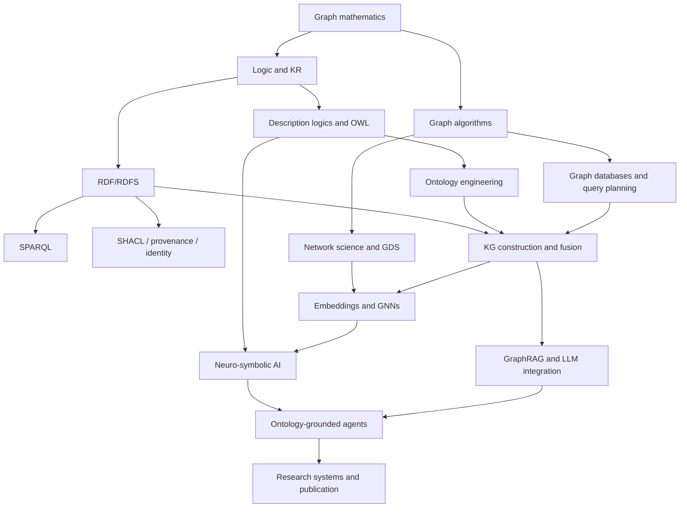

# Graph Field Mastery Home

> [!abstract] Purpose
> Build the ability to **model meaning, integrate evidence, query relationships, discover structure, learn over graphs, design reliable agents, and conduct publishable research**. This is not a tool tutorial. It is a problem-solving curriculum for the complete graph field.

## Your starting advantage

This roadmap assumes strong computer science, statistics, mathematics, machine learning, deep learning, GenAI and agentic-AI foundations. Therefore, it does not spend months reteaching linear algebra, probability, Python, neural-network optimization or transformer basics. It concentrates on what is graph-specific: relational inductive bias, formal semantics, identity, multi-hop structure, graph system behavior, reasoning guarantees, graph-specific evaluation and the engineering consequences of connected data.

## The central distinction

A graph-shaped dataset is not automatically a knowledge graph, and a knowledge graph is not automatically an ontology.

- A **graph** gives vertices and edges.
- A **graph database** gives persistence, indexing, transactions and traversal/query execution.
- A **knowledge graph** gives identified entities, typed relations, context, provenance and a deliberate interpretation.
- An **ontology** gives an explicit conceptualization: vocabulary, commitments, axioms and often machine-checkable semantics.
- **Graph analytics** extracts structural patterns.
- **Graph ML** learns predictive representations from topology and features.
- **GraphRAG** retrieves connected evidence for generation; it does not by itself guarantee truth or logical validity.

## Study system

- [[01_How_to_Study_This_Book]] - how to turn reading into mastery evidence.
- [[02_Knowledge_Map_and_Dependencies]] - prerequisite and concept map.
- [[03_Glossary_of_Graph_Fields]] - compact orientation to the major fields.
- [[04_Progress_Dashboard]] - chapter, lab, project and paper tracking.
- [[00_Templates_Index]] - reusable research, experiment, ontology and project notes.

## Book map

### Part I — Foundations

1. [[01_Graph_Mathematics_and_Representations]]
2. [[02_Graph_Algorithms_and_Complexity]]
3. [[03_Logic_Knowledge_Representation_and_Semantics]]
4. [[04_Uncertainty_Causality_and_Probabilistic_Graphs]]

### Part II — Semantic Web and Ontology

5. [[05_RDF_RDFS_and_Linked_Data]]
6. [[06_SPARQL_Query_and_Federation]]
7. [[07_Description_Logics_and_OWL_2]]
8. [[08_Ontology_Engineering_Methodology]]
9. [[09_SHACL_SKOS_Rules_Provenance_and_Identity]]
10. [[10_Upper_Ontologies_and_Design_Patterns]]
11. [[11_Reasoners_and_Semantic_System_Architecture]]

### Part III — Graph Databases and Systems

12. [[12_Property_Graphs_Cypher_GQL_and_Gremlin]]
13. [[13_Graph_Database_Internals_and_Distributed_Systems]]
14. [[14_RDF_vs_Property_Graphs_and_Interoperability]]

### Part IV — Knowledge-graph construction and quality

15. [[15_KG_Construction_from_Structured_Data]]
16. [[16_KG_Construction_from_Text_and_Multimodal_Data]]
17. [[17_Entity_Resolution_and_Knowledge_Fusion]]
18. [[18_KG_Quality_Governance_and_Evolution]]
19. [[19_Temporal_Spatial_Probabilistic_and_Hyper_KGs]]

### Part V — Analytics and graph data science

20. [[20_Network_Science_and_Graph_Analytics]]
21. [[21_Graph_Data_Science_Workflows]]
22. [[22_Graph_Algorithm_Selection_Guide]]

### Part VI — Graph machine learning

23. [[23_Knowledge_Graph_Embeddings_and_Link_Prediction]]
24. [[24_Graph_Neural_Network_Foundations]]
25. [[25_Relational_Heterogeneous_and_Temporal_GNNs]]
26. [[26_Graph_Transformers_and_Graph_Foundation_Models]]
27. [[27_Neuro_Symbolic_AI_and_Logical_Learning]]
28. [[28_Graph_ML_Evaluation_Datasets_and_Benchmarks]]

### Part VII — LLMs, GraphRAG and agents

29. [[29_Knowledge_Graph_and_LLM_Integration]]
30. [[30_GraphRAG_and_Hybrid_Retrieval]]
31. [[31_Ontology_Grounded_Agents]]
32. [[32_Graph_Memory_Planning_and_Multi_Agent_Systems]]
33. [[33_Safety_Evaluation_and_Production_Operations]]

### Part VIII — Execution and research

34. [[34_12_to_18_Month_Curriculum]]
35. [[35_First_30_60_90_Days]]
36. [[36_Labs_and_Exercises]]
37. [[37_Portfolio_and_Research_Projects]]
38. [[38_Research_Frontiers_and_Open_Problems]]
39. [[39_Paper_Reading_Reproduction_and_Writing]]
40. [[40_Career_and_Research_Positioning]]

### Reference library

- [[41_Toolchain_Setup]]
- [[42_Annotated_Bibliography]]
- [[43_Courses_and_Video_Lectures]]
- [[44_Papers_by_Topic]]
- [[45_Datasets_and_Benchmarks_Catalog]]
- [[46_Query_and_Code_Cookbook]]
- [[47_Decision_Trees_for_Graph_Problems]]
- [[48_Current_Standards_Status_2026]]
- [[49_Glossary]]

## Dependency graph

## What “expert” means here

You are approaching expert level when you can do all of the following without hiding behind a vendor product:

1. Translate an ambiguous domain problem into competency questions, ontology commitments, graph patterns, data contracts and evaluation criteria.
2. Explain why a class, instance, event, relation, attribute, statement, named graph or reified assertion was chosen.
3. Select RDF/OWL, a property graph, a dual model, or no graph at all based on workload and semantics.
4. Predict how open-world semantics, identity assumptions, inference and incomplete data will change an answer.
5. Diagnose slow graph queries from cardinality, branching factor, path semantics, join order and index use.
6. Build ingestion, entity resolution, provenance, validation, versioning and observability into the KG lifecycle.
7. Separate descriptive graph analytics from causal claims and predictive ML.
8. Design honest KGE/GNN experiments with leakage-resistant splits and meaningful baselines.
9. Build GraphRAG/agent systems whose evidence paths, tool calls, confidence and failures are inspectable.
10. Reproduce a paper, identify its hidden assumptions, and propose a controlled extension.

## Mastery gates

| Gate | Evidence required |
|---|---|
| Foundation | Derive and implement core algorithms; explain graph representations and complexity. |
| Semantic modeler | Build a tested OWL ontology with competency questions, SHACL and reasoning. |
| Graph engineer | Operate RDF and property-graph systems; profile queries and design indexes. |
| KG engineer | Construct a provenance-aware KG with measurable entity-resolution and quality metrics. |
| Graph scientist | Run graph analytics and ML with leakage-resistant evaluation and ablations. |
| Agent architect | Build a hybrid vector/graph/logic agent with traceable answers and guardrails. |
| Researcher | Reproduce one paper, release code/data cards, and submit a defensible new result. |

## Start today

- [ ] Open [[04_Progress_Dashboard]] and record your start date.
- [ ] Read [[01_How_to_Study_This_Book]].
- [ ] Draw your current skill map using [[02_Knowledge_Map_and_Dependencies]].
- [ ] Install the minimum stack in [[41_Toolchain_Setup]].
- [ ] Begin the first sprint in [[35_First_30_60_90_Days]].
- [ ] Create your first experiment note from [[Template - Experiment Note]].
