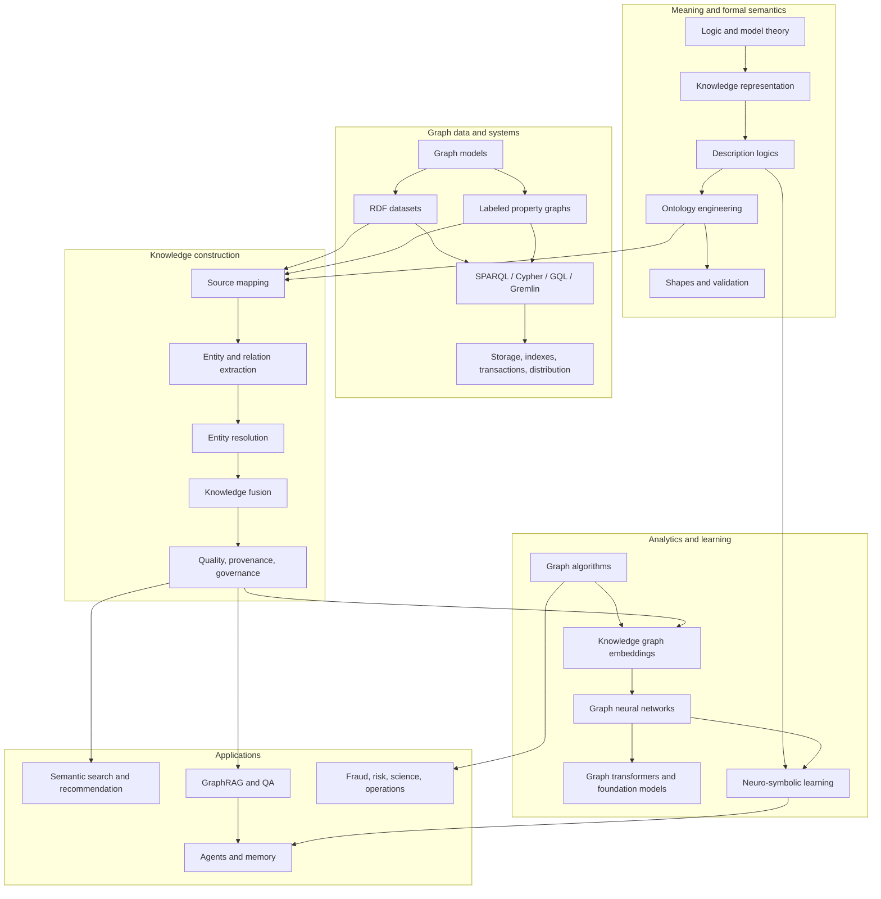
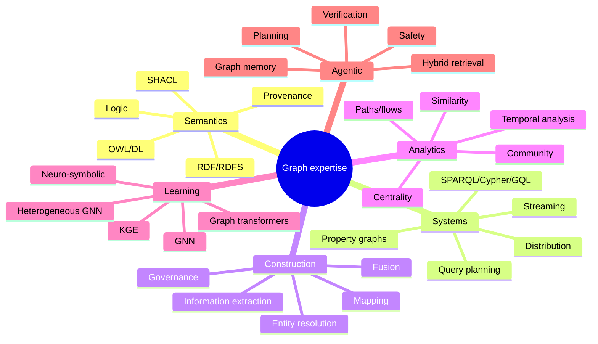

# Knowledge Map and Dependencies

## The field as a layered system

## Dependencies that are often missed

### Ontology depends on logic, not on drawing boxes

A taxonomy can be created by arranging labels. An ontology requires clarity about interpretation, identity, quantification, constraints and inference. Without logic, `subClassOf`, `domain`, `range`, `some`, `only`, cardinality and disjointness are easily misused.

### Graph ML depends on data semantics

A GNN can aggregate neighbors without knowing whether an edge means “owns”, “is similar to”, “was cited by” or “occurred before”. Direction, edge type, timestamps, duplicate entities and sampling policy determine what its representation means. A stronger model cannot repair a conceptually wrong graph.

### GraphRAG depends on construction and evaluation

Graph retrieval is only as reliable as extraction, identity resolution, provenance and query planning. A fluent answer does not reveal whether the graph omitted an entity, merged two people, followed an invalid temporal edge or used an unsupported statement.

### Production depends on lifecycle

A correct prototype can fail in production because of schema evolution, deletions, stale embeddings, permission changes, re-indexing cost, query-plan instability or untraceable LLM extraction. Governance is part of architecture, not documentation added later.

## Parallel learning tracks

### Track A — Formal and semantic

`Logic → RDF/RDFS → Description logics → OWL → ontology engineering → SHACL/rules → reasoning architecture`

Deliverable: a versioned ontology with competency questions, examples, counterexamples, automated checks and release governance.

### Track B — Data systems and analytics

`Graph models → query languages → database internals → graph algorithms → graph data science → distributed execution`

Deliverable: the same domain represented and benchmarked in an RDF store and a property-graph database, with documented query plans and workload trade-offs.

### Track C — Learning and agentic systems

`KGE → GNN → heterogeneous/temporal learning → graph transformers → GraphRAG → ontology-grounded agents → neuro-symbolic research`

Deliverable: an evaluated hybrid retrieval/reasoning system whose evidence and failure modes are inspectable.

## Topic dependency matrix

| Topic | Must understand first | Can learn concurrently | Output |
|---|---|---|---|
| RDF | sets, relations, identifiers | basic SPARQL | small linked dataset |
| OWL | FOL/model theory, RDF | Protégé | classified ontology |
| SHACL | RDF, graph patterns | SPARQL | validation suite |
| Cypher/GQL | property graphs, relational algebra intuition | Neo4j | profiled query workload |
| Entity resolution | probability, string/embedding similarity | ontology/schema | labeled pair benchmark |
| Graph analytics | graph theory, null models | NetworkX/GDS | structural analysis report |
| KGE | optimization, negative sampling | ontology constraints | link-prediction experiment |
| GNN | message passing, sampling | PyG/DGL | inductive benchmark |
| GraphRAG | retrieval evaluation, KG construction | LLM orchestration | traced QA system |
| Ontology-grounded agents | tool safety, formal constraints, GraphRAG | multi-agent orchestration | constrained agent workflow |

## Suggested order for your background

Because you already know ML/DL/GenAI, resist jumping directly to GraphRAG. The fastest route to durable expertise is:

1. Spend 6–8 weeks on semantics, RDF/OWL and ontology engineering.
2. Spend 4–6 weeks on graph query systems and database behavior.
3. Spend 6–8 weeks on construction, entity resolution and quality.
4. Then combine analytics, graph ML and agents.

This order changes your mental model from “LLM extracts triples” to “a governed evidence system represents claims under explicit commitments.”

## Self-assessment map

Create a copy and assign each node 0–4 using the rubric in [[01_How_to_Study_This_Book]].

## Completion is not linear

You will revisit earlier chapters. For example:

- An entity-resolution error may reveal an ontology identity mistake.
- A slow SPARQL query may reveal an over-general data model.
- A GNN failure may reveal that edges were projected incorrectly.
- An agent hallucination may reveal missing provenance or invalid tool scope.

The roadmap therefore uses spirals: **foundation → application → failure → deeper foundation**.
