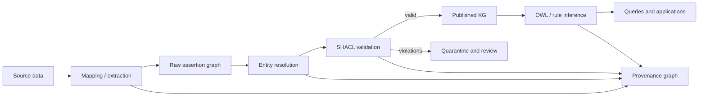

# SHACL, SKOS, Rules, Provenance and Identity

> [!goal]
> Complete the semantic stack by separating validation, concept organization, derivation, provenance and identity.

## 1. Why OWL is not enough

OWL states logical truths under open-world semantics. Applications also need:

- required fields;
- datatype and cardinality checks against a submitted graph;
- allowed value lists;
- cross-field conditions;
- controlled concept schemes;
- derivation rules;
- statement/source metadata;
- identity and mapping confidence.

Use specialized mechanisms rather than forcing every concern into OWL.

## 2. SHACL basics

A SHACL shapes graph describes constraints over a data graph.

```turtle
@prefix sh: <http://www.w3.org/ns/shacl#> .
@prefix ex: <https://example.org/auto/> .
@prefix xsd: <http://www.w3.org/2001/XMLSchema#> .

ex:DealerShape a sh:NodeShape ;
  sh:targetClass ex:Dealer ;
  sh:property [
    sh:path ex:legalName ;
    sh:minCount 1 ;
    sh:maxCount 1 ;
    sh:datatype xsd:string ;
  ] ;
  sh:property [
    sh:path ex:dealerCode ;
    sh:minCount 1 ;
    sh:pattern "^[A-Z0-9]{5,10}$" ;
  ] .
```

A focus node conforms when no applicable constraint produces a violation at the selected severity/processing policy.

## 3. Targets and paths

Targets select focus nodes by class, subject/object of a property, explicit node or extension. Property paths can include inverse, sequence and alternatives. Keep targets explicit; accidental targeting can turn a small validation into a full-graph scan.

## 4. Core constraints

Important constraints include:

- `minCount`, `maxCount`;
- `datatype`, `nodeKind`, `class`;
- numeric/string length bounds;
- regex `pattern`;
- `in` value enumeration;
- `hasValue`;
- `equals`, `disjoint`, `lessThan`;
- `or`, `and`, `not`, `xone`;
- nested `node` shape;
- `qualifiedValueShape` counts;
- `closed` shape with ignored properties.

Closed shapes are useful for strict APIs but can conflict with RDF extensibility. Apply them at controlled boundaries, not necessarily to the whole enterprise KG.

## 5. SHACL-SPARQL and advanced constraints

SPARQL constraints express conditions not covered by Core. Example: an observation end date must not precede its start date. SPARQL constraints are powerful but can be slower, less portable and harder to analyze. Prefer Core where possible and test query plans.

## 6. SHACL 1.0 and 1.2 status

SHACL 1.0 became a W3C Recommendation in 2017. As of **5 November 2026**, SHACL 1.2 Core and related work—such as inference rules and UI descriptions—are Working Drafts. Drafts introduce useful capabilities but must be versioned and interoperability-tested before production reliance.

## 7. SHACL versus OWL

| Requirement | OWL | SHACL |
|---|---|---|
| infer types from domain truth | strong | possible via rules/extensions |
| state universal class semantics | strong | not primary purpose |
| require recorded property | OWA makes this indirect | `minCount` |
| reject too many values | equality may be inferred | `maxCount` reports violation |
| validate regex/datatype | limited semantic role | direct |
| closed records | not natural | `sh:closed` |
| reasoner classification | yes | no, except extension/rule workflows |

Use both: OWL for meaning, SHACL for data contracts.

## 8. SKOS concept schemes

SKOS represents thesauri, classifications and controlled vocabularies:

- `skos:Concept`;
- `skos:ConceptScheme`;
- `skos:prefLabel`, `altLabel`, `hiddenLabel`;
- `broader`, `narrower`, `related`;
- mapping properties such as `exactMatch`, `closeMatch`, `broadMatch`.

A SKOS broader relation is not automatically the same as `rdfs:subClassOf`. A concept in a taxonomy can be treated as an individual used to tag resources, avoiding OWL metamodeling.

## 9. Rules

Rule options include:

- RDFS/OWL RL materialization;
- Datalog;
- SHACL rules;
- SWRL in compatible reasoners;
- Apache Jena rule syntax;
- vendor-specific graph rules;
- application/event rules.

Rule design decisions:

- forward or backward chaining;
- monotonic or non-monotonic behavior;
- recursion and termination;
- negation semantics;
- aggregate support;
- incremental maintenance;
- explanation/provenance of derived facts.

A derived fact should retain the rule, source facts, execution version and timestamp when auditability matters.

## 10. Provenance with PROV-O

PROV-O centers on:

- `prov:Entity` — a thing/data artifact;
- `prov:Activity` — process that acts on entities;
- `prov:Agent` — responsible actor/system;
- relations such as `wasGeneratedBy`, `used`, `wasAttributedTo`, `wasDerivedFrom`.

Example:

```turtle
ex:claim-55 a ex:SalesClaim, prov:Entity ;
  prov:wasGeneratedBy ex:extraction-run-19 ;
  prov:wasDerivedFrom ex:report-2026-04 .

ex:extraction-run-19 a prov:Activity ;
  prov:used ex:model-version-7 ;
  prov:wasAssociatedWith ex:kg-pipeline .
```

PROV-O gives a general vocabulary; define domain-specific claim and evidence patterns around it.

## 11. Statement-level provenance patterns

### Named graph pattern

Group source assertions in a named graph and describe the graph. Efficient, but provenance granularity is the graph group.

### Reification/statement node

Create a resource representing the assertion and attach subject/predicate/object plus metadata. Verbose but explicit and portable.

### N-ary claim node

Model the domain assertion as a `Claim`/`Observation` with participants and values. Often best when the statement has time, source, confidence and lifecycle.

### RDF 1.2 triple term

Use a triple term as the object of metadata statements when supported end to end. Verify draft-version interoperability and query syntax.

## 12. Identity lifecycle

An identity system should expose:

1. source records;
2. candidate pair evidence;
3. match decisions and score;
4. canonical entity;
5. merge/split history;
6. human overrides;
7. external mappings;
8. temporal validity.

Do not erase source identifiers after canonicalization. A future split requires lineage.

## 13. Mappings and semantic strength

| Relation | Intended strength |
|---|---|
| `owl:sameAs` | full logical identity |
| `skos:exactMatch` | high interchangeability between concepts, not OWL identity |
| `skos:closeMatch` | close but not exact concept mapping |
| `rdfs:subClassOf` | universal set inclusion |
| custom `sameBusinessEntityAs` | scoped business equivalence |
| custom `candidateMatch` | uncertain matching evidence |

Mapping strength should be part of an alignment policy and test suite.

## 14. Validation architecture



Validate at multiple stages. Raw data may use permissive shapes; published entities use stricter shapes. Inferred graphs may require different validation because reasoners add values.

## 15. Severity and handling

SHACL defines severity terms such as violation, warning and info. Operational policy decides whether a result blocks ingestion, quarantines a record, creates a ticket or only adds a quality score. Do not silently ignore warnings forever.

## 16. Exercises

1. Build SHACL shapes for dealer, observation and recommendation data, including a SPARQL temporal constraint.
2. Represent a vehicle taxonomy in SKOS and explain why it is not an OWL class hierarchy.
3. Create PROV-O records for an LLM extraction pipeline and a human correction.
4. Model an uncertain identity match without `owl:sameAs`.
5. Implement a rule that derives an alert and records its supporting facts.
6. Compare named-graph, statement-node and triple-term provenance for 1 million claims.

## Primary sources

- SHACL Recommendation: https://www.w3.org/TR/shacl/
- SHACL 1.2 Core Working Draft: https://www.w3.org/TR/shacl12-core/
- SHACL 1.2 Inference Rules: https://www.w3.org/TR/shacl12-inference-rules/
- SKOS Reference: https://www.w3.org/TR/skos-reference/
- PROV-O: https://www.w3.org/TR/prov-o/
- RDF 1.2 Concepts: https://www.w3.org/TR/rdf12-concepts/

## Next

Study reuse and foundational commitments in [[10_Upper_Ontologies_and_Design_Patterns]].
