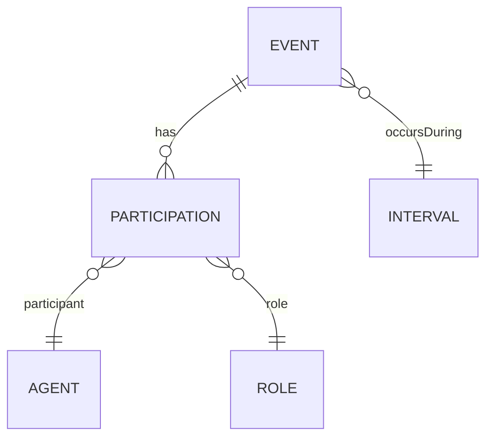

# Upper Ontologies and Ontology Design Patterns

> [!goal]
> Decide when a top-level ontology or design pattern improves interoperability—and when it only adds complexity.

## 1. Why upper ontologies exist

Domain ontologies repeatedly need general distinctions:

- object versus process;
- quality versus measurement;
- role versus type;
- information artifact versus the thing described;
- continuant versus event;
- parthood, location and participation;
- time and change.

An upper ontology supplies shared categories and relations so multiple domain ontologies align. Adoption is a semantic commitment and can reshape the entire model.

## 2. Basic Formal Ontology (BFO)

BFO is a realist top-level ontology standardized as ISO/IEC 21838-2:2021. It distinguishes broadly:

- **continuants** — persist through time while maintaining identity;
- **occurrents** — unfold or happen in time;
- independent and specifically dependent continuants;
- qualities, roles and dispositions;
- material entities, sites and spatial/temporal regions.

BFO is influential in biomedical and scientific ontology ecosystems such as OBO. It is valuable when cross-domain scientific interoperability and realist modeling are priorities.

## 3. DOLCE

DOLCE is oriented toward categories reflected in natural language and human conceptualization. It distinguishes endurants, perdurants, qualities and abstract entities, with attention to participation and social/cognitive artifacts. It can fit information and social domains where conceptualization is central.

## 4. SUMO

SUMO is a broad formal upper ontology with many domain extensions and mappings. It covers objects, processes, relations, quantities and more. Its breadth is useful for general knowledge representation, but importing large portions may exceed an application’s needs.

## 5. Other foundational resources

- schema.org: pragmatic web vocabulary, not a fully axiomatized upper ontology.
- CIDOC CRM: event-centric cultural-heritage reference model.
- SOSA/SSN: sensors, observations, samples and actuators.
- QUDT/OM: quantities, units and measurements.
- PROV-O: provenance.
- OBO Relation Ontology: interoperable relations in OBO ecosystems.

The best reusable resource may be a mid-level ontology or pattern rather than a universal top level.

## 6. Decision criteria for upper-ontology adoption

Adopt when:

- several domain ontologies must integrate;
- category mistakes are recurring;
- the target community already uses it;
- formal interoperability matters more than minimal complexity;
- you have governance and expertise to maintain alignment.

Avoid or delay when:

- a narrow application has few shared concepts;
- the team cannot explain the commitments;
- adoption is driven by prestige;
- import size and reasoning cost are unjustified;
- mappings would be speculative.

A thin alignment module can preserve optionality: keep domain terms stable and map selected terms to the upper ontology.

## 7. Ontology design patterns (ODPs)

An ODP is a reusable solution to a recurring modeling problem. Categories include:

- content patterns;
- structural/logical patterns;
- naming and transformation patterns;
- reasoning patterns;
- presentation patterns.

Patterns are analogous to software design patterns: they encode a solution and trade-offs, not a universally correct schema.

## 8. Core patterns

### Participation/event pattern

Represent an event as an entity with participants, roles, time and location.



Use when a relation changes over time or has metadata.

### Time-indexed relation

Turn `Alice manages Dealer101` into a management assignment with interval. It avoids attaching temporal qualifiers awkwardly to a binary relation.

### Observation/measurement

Separate feature/phenomenon, property measured, result value, unit, method and time. This prevents comparing incompatible grains or units.

### Information artifact and aboutness

A recommendation document is not the same as the recommended action. A legal judgment document is not identical to the adjudication event or legal proposition.

### Classification pattern

Represent concepts as SKOS individuals and link domain entities with `hasClassification`. Useful when categories are governed vocabularies rather than logical classes.

### Provenance-qualified assertion

Represent a claim with content, source, time, confidence and status. Essential for multi-source or LLM-extracted KGs.

### Part–whole pattern

Distinguish component, member, portion, place and feature relations. Transitivity may hold for some variants but not all.

## 9. Pattern composition

Patterns can conflict. For example, a BFO-aligned role is a realizable dependent continuant, while a lightweight application may treat roles as SKOS concepts. If combining:

1. state each pattern’s commitment;
2. identify shared terms;
3. test whether axioms imply unwanted equivalences;
4. keep mapping modules separate;
5. test CQs after composition.

## 10. Pattern selection workflow

1. Bound the subproblem with CQs.
2. Collect local examples and counterexamples.
3. Search a pattern catalog and domain standards.
4. Compare commitments, not just diagrams.
5. specialize names and constraints.
6. test logical consequences and query impact.
7. record adoption decision and provenance.

## 11. Automotive example

Problem: a dealer receives allocation under a program and may appeal.

Bad model:

```text
Dealer --hasAllocation--> VehicleModel
```

Better pattern:

- `AllocationDecision` event/information artifact;
- dealer, model, quantity and program as participants/fields;
- validity interval;
- generating policy version;
- appeal event and status;
- evidence/provenance.

The richer model enables temporal questions, source audit and multiple allocations without overwriting edges.

## 12. Legal-KG example

Distinguish:

- legal text/document;
- legal provision as versioned information content;
- enactment/amendment/repeal events;
- jurisdiction;
- interpretation claim;
- court decision event;
- citation relation valid at decision time.

This prevents treating a section’s text across amendments as one timeless literal.

## 13. OBO Foundry lessons beyond biomedicine

OBO principles emphasize:

- open access;
- common format;
- unique identifier space;
- versioning;
- explicit scope;
- textual definitions;
- reuse of relations;
- documentation;
- collaborative maintenance;
- term stability and responsiveness.

These are broadly useful governance principles even outside biological ontologies.

## 14. Anti-patterns

- Importing an upper ontology but never using its distinctions.
- Mapping every term directly to `Entity` or `Process` with no operational value.
- Treating classes and SKOS concepts interchangeably.
- Declaring all part relations transitive.
- Copying a pattern without its assumptions.
- Encoding the source database layout as ontology categories.
- Using event nodes for every trivial attribute, creating needless joins.

## Exercises

1. Align an automotive ontology to BFO, DOLCE or neither; write a two-page decision.
2. Model manager assignment using a direct edge and time-indexed relation; compare CQs.
3. Apply observation and provenance patterns to a sales metric.
4. Review ten existing ontology terms for role/type confusion.
5. Compose two ODPs and identify any unintended entailments.
6. Create a thin alignment module rather than directly importing an upper ontology.

## Authoritative resources

- ISO/IEC 21838-2 BFO: https://www.iso.org/standard/74572.html
- BFO project: https://basic-formal-ontology.org/
- OBO Foundry: https://obofoundry.org/
- Ontology Design Patterns portal: http://ontologydesignpatterns.org/
- CIDOC CRM: https://www.cidoc-crm.org/
- W3C SOSA/SSN: https://www.w3.org/TR/vocab-ssn/
- QUDT: https://qudt.org/

## Next

Learn deployment and inference strategy in [[11_Reasoners_and_Semantic_System_Architecture]].
