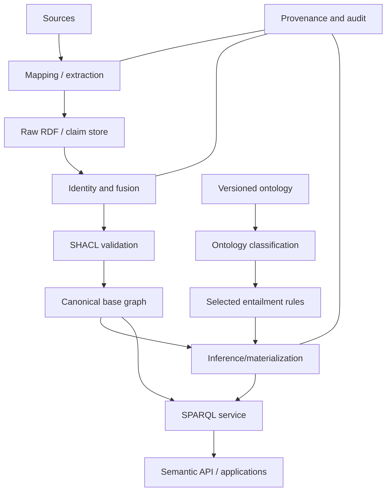

# Reasoners and Semantic System Architecture

> [!goal]
> Choose reasoning and storage architecture by workload, semantics and operational constraints.

## 1. Reasoning strategies

### Materialization / forward chaining

Precompute entailed triples and store them. Queries are fast, but updates require maintaining closure and may expand storage.

Best when:

- rules are stable;
- read volume dominates;
- derived facts are reused;
- provenance of derivation can be maintained.

### Query rewriting / backward reasoning

Rewrite a query using ontology axioms, then evaluate against base data. It avoids storing closure but can produce large rewritten queries.

Best when:

- instance data is large and relational;
- ontology is in a suitable profile such as OWL 2 QL;
- updates are frequent;
- query latency remains acceptable.

### Tableau/hypertableau reasoning

Model-building procedures support expressive DL reasoning such as consistency and classification. HermiT is a prominent OWL 2 DL reasoner.

Best for:

- ontology development;
- expressive TBox classification;
- explanation of inconsistencies;
- moderate ABox workloads.

### Rule engines

RDFS/OWL RL or custom Datalog-style rules can scale through fixed-point evaluation. They need termination, recursion and negation semantics to be explicit.

### Hybrid systems

A common architecture classifies the ontology offline, materializes selected schema consequences, validates with SHACL, and uses application-specific rules/queries online.

## 2. Reasoner families and tools

| Tool | Strength | Caution |
|---|---|---|
| HermiT | expressive OWL 2 DL, direct semantics | not designed as high-throughput enterprise ABox store |
| ELK | fast OWL 2 EL classification, incremental/concurrent | only EL profile; warns on unsupported features |
| Openllet/Pellet lineage | OWL reasoning and rules in Java ecosystem | check active version and conformance |
| Apache Jena | RDF APIs, rule reasoners, SHACL, TDB2/Fuseki | built-in OWL support is not a complete OWL 2 DL reasoner |
| GraphDB | RDF store with configurable rule-based inference | rule set and edition determine behavior |
| RDF4J | Java RDF framework and repositories | inference depends on Sail/repository configuration |
| Owlready2 | Python ontology-oriented programming and HermiT/Pellet integration | good for prototypes; profile performance at scale |
| Protégé | ontology editor with reasoner plugins | development environment, not production server |

Do not select solely by brand. Create a conformance and workload matrix.

## 3. Architecture layers

Separate raw evidence from canonical and inferred graphs. This permits reprocessing after ontology or entity-resolution changes.

## 4. Truth maintenance

When a source fact is deleted, derived facts depending on it may need retraction. Strategies:

- full rematerialization;
- dependency tracking/truth-maintenance system;
- counting derivations;
- incremental rule evaluation;
- immutable versioned snapshots.

Retraction is harder than insertion. Include it in the architecture before promising real-time updates.

## 5. Reasoning scope

Possible scopes:

- ontology/TBox only;
- schema plus selected instance graph;
- per-tenant graph;
- per-request context;
- trusted sources only;
- snapshot/version;
- security-filtered view.

Reasoning across access-controlled data can leak restricted facts through inference. Authorization must apply to explicit and derived information.

## 6. Explanations and justifications

For critical inferred facts, retain:

- conclusion;
- rule/axiom;
- supporting premises;
- ontology/rule version;
- source provenance;
- generation timestamp;
- confidence/status if non-logical components were involved.

A minimal logical justification is not necessarily the best human explanation. Build user-facing explanations from validated provenance and domain terms.

## 7. Inconsistency handling

Options:

1. reject/quarantine inconsistent data;
2. partition by source or named graph;
3. use local closed-world validation before inference;
4. weaken problematic axioms;
5. employ paraconsistent reasoning for conflict-tolerant domains;
6. represent statements as claims rather than asserting all into one theory.

Do not silently disable disjointness merely to make the reasoner pass. Diagnose whether the ontology or data is wrong.

## 8. Inference and performance

Measure separately:

- ontology load/classification time;
- materialization time and expansion ratio;
- incremental update cost;
- query latency with/without entailment;
- memory and disk use;
- explanation latency;
- throughput under concurrent reads/writes.

A simple RDFS closure can greatly expand highly hierarchical datasets. Property chains and same-as closure can create dense effects.

## 9. Semantic caching

Cache results using keys that include:

- query and parameters;
- active dataset/named graphs;
- ontology/rule version;
- access scope;
- source snapshot;
- entailment regime.

Otherwise a cached answer may survive a semantic change or cross a permission boundary.

## 10. Ontology-based data access (OBDA)

OBDA maps relational sources to an ontology and rewrites semantic queries to SQL, often using R2RML-like mappings and OWL QL-style ontologies. It avoids copying data but depends on mapping quality, source performance and supported query fragments.

Choose virtual access when:

- source freshness is essential;
- duplication is costly;
- query workload is bounded;
- mappings are stable.

Choose materialization when:

- cross-source integration and graph analytics dominate;
- source systems cannot handle semantic workloads;
- historical snapshots and enrichment are needed.

Hybrid architectures materialize selected entities/relationships and federate long-tail attributes.

## 11. Semantic API design

Do not expose raw SPARQL to every consumer. Provide:

- stable domain endpoints;
- parameter validation;
- explicit version and entailment metadata;
- pagination and timeouts;
- provenance/evidence links;
- schema discovery;
- bulk export for analytical users;
- restricted expert SPARQL endpoint where justified.

Natural-language interfaces must show the interpreted query and evidence rather than hiding ambiguity.

## 12. Deployment checklist

- [ ] Stable ontology and mapping versions pinned.
- [ ] Reasoner/profile conformance verified.
- [ ] Raw, canonical and inferred layers separated.
- [ ] SHACL gates and quarantine workflow defined.
- [ ] Inference retraction strategy tested.
- [ ] Permission inference leakage tested.
- [ ] Query plans and limits monitored.
- [ ] Backup/restore includes ontology and rule versions.
- [ ] Derived-fact provenance available.
- [ ] Disaster recovery tested with rematerialization.
- [ ] Draft-standard features isolated behind compatibility tests.

## 13. Labs

1. Classify the same OWL ontology using HermiT and ELK; identify unsupported features and timing.
2. Configure Jena or GraphDB with RDFS/OWL RL inference and compare explicit versus entailed query results.
3. Delete a source fact and test whether derived facts retract correctly.
4. Implement a CQ regression suite across two reasoner versions.
5. Benchmark materialization versus query rewriting for a small OBDA workload.
6. Design a permission-aware reasoning test where a derived fact could leak restricted information.

## Authoritative resources

- HermiT: https://www.hermit-reasoner.com/
- ELK: https://github.com/liveontologies/elk-reasoner
- Apache Jena inference: https://jena.apache.org/documentation/inference/
- Apache Jena documentation: https://jena.apache.org/documentation/
- GraphDB documentation: https://graphdb.ontotext.com/documentation/
- Owlready2: https://owlready2.readthedocs.io/en/latest/
- RDF4J: https://rdf4j.org/documentation/

## Next

Move to graph database models and standardized property-graph querying in [[12_Property_Graphs_Cypher_GQL_and_Gremlin]].
