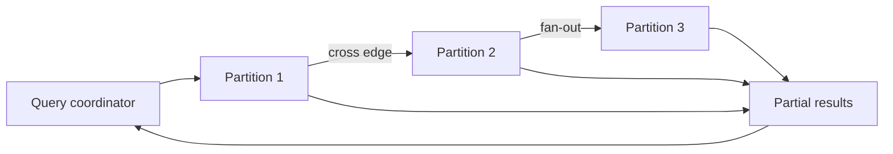

# Graph Database Internals and Distributed Systems

> [!goal]
> Understand why graph workloads are fast or slow by tracing storage, indexes, operators, transactions, partitioning and distributed execution.

## 1. Start with the workload

"Graph database" is not one architecture. Relevant workload dimensions are:

- OLTP point lookups and local traversals;
- analytical scans and iterative algorithms;
- RDF triple-pattern joins;
- property-graph pattern matching;
- write rate and update locality;
- graph size, degree distribution and property volume;
- consistency, availability and recovery objectives;
- single-node, scale-up or distributed deployment.

The same dataset can require separate serving and analytical representations.

## 2. Storage layouts

### Native adjacency-oriented storage

Nodes and edges have records/pointers or compressed adjacency lists. Traversal can follow local adjacency without a global join. Advantages are predictable neighborhood access and natural path expansion. Costs include pointer chasing, random I/O, difficult partitioning and property indirection.

### Relational representation

Common tables are `node`, `edge(source,target,type,...)`, label and property tables. Mature optimizers, transactions and column stores are useful, especially for bounded joins and aggregation. Deep variable-length traversal can be awkward but recursive SQL and modern graph extensions reduce the gap.

### RDF stores

An RDF triple table can be indexed in several permutations such as SPO, POS and OSP. Quad stores add graph/context. Dictionary encoding maps IRIs/literals to compact IDs. Query execution becomes selective triple scans plus joins, often with inference or entailment layers.

### Columnar/CSR analytical layout

Compressed sparse row (CSR) stores offset and neighbor arrays, supporting high-throughput sequential graph computation. CSC stores incoming adjacency. These are efficient for algorithms but expensive to update incrementally.

> [!insight]
> Serving systems optimize **small neighborhoods under transactions**. Analytical systems optimize **large repeated scans over a projected graph**. A production architecture may intentionally use both.

## 3. Indexes

Indexes answer "where should the traversal start?" Typical forms include:

- B-tree/range and composite indexes;
- hash indexes;
- full-text indexes;
- vector indexes;
- node label/type indexes;
- edge type and endpoint indexes;
- RDF permutation indexes;
- geospatial and temporal indexes.

An index usually helps anchor a selective node or property. It does not make every following expansion cheap. A single high-degree hub can dominate runtime.

## 4. Logical and physical plans

A logical graph plan contains pattern scans, expansions, joins, filters, projection, aggregation, distinctness, sorting, path search and updates. The physical plan chooses algorithms and ordering.

Key operators:

- node/index scan;
- expand-from / expand-into;
- hash join, merge join, index nested-loop join;
- semi/anti join for existence;
- apply/correlated subquery;
- variable-length expansion;
- shortest-path search;
- aggregation and top-k;
- materialization/eager barrier.

The optimizer estimates cardinalities from statistics. Graph data violates simple independence assumptions: degrees are skewed, types correlate, communities cluster, and paths revisit dense regions. Estimation error leads to poor join order or excessive materialization.

## 5. Complexity of graph patterns

A fixed bounded pattern is often manageable, but expressive path queries can be expensive. Complexity changes with:

- arbitrary path length;
- simple-path constraints;
- regular path expressions;
- all-path enumeration;
- negation and optional patterns;
- subgraph isomorphism-like matching.

Ask whether the application needs existence, one witness path, shortest path, top-k paths, path count, or every path. They are not equivalent workloads.

## 6. Transactions and concurrency

A production graph store must define:

- atomicity, consistency, isolation, durability;
- lock or multiversion concurrency control;
- deadlock detection/retry;
- uniqueness-constraint enforcement;
- causal or serializable guarantees;
- cluster replication and failover;
- backup, restore and point-in-time recovery.

Graph writes can lock connected records or constraint indexes. Batch ingestion should use bounded transactions and deterministic merge keys.

### Idempotency pattern

Store source system, source record ID, event time, ingestion batch and content hash. On replay, determine whether to ignore, update, version or quarantine.

## 7. Partitioning

Graph partitioning seeks to minimize cross-partition edges while balancing storage and computation. This is hard because real graphs are skewed and evolve.

Strategies:

- edge-cut: assign nodes to partitions; crossing edges require communication;
- vertex-cut: assign edges and replicate high-degree vertices;
- hash partitioning: simple balance, poor locality;
- community/range/domain partitioning: better locality, may become imbalanced;
- workload-aware partitioning: optimize observed query paths;
- replication/caching of hot neighborhoods.

Distributed traversals can suffer network amplification. A query that looks like three hops may fan out across many machines.

## 8. Distributed analytical models

### Pregel/BSP

Computation advances in synchronized supersteps. Vertices receive messages, update state and send messages. Easy to reason about, but barriers and stragglers cost time.

### GAS

Gather-Apply-Scatter separates neighborhood aggregation, vertex update and propagation.

### Dataflow and sparse-linear-algebra models

Graph operations are represented as joins/dataflows or matrix operations. They benefit from mature distributed engines and hardware acceleration.

Algorithm choice and partition strategy interact. PageRank, connected components and triangle counting have very different communication patterns.

## 9. RDF query internals

SPARQL basic graph patterns are conjunctive joins over triple patterns. Optional, union, filter, property paths, aggregation and federation add complexity. Optimizers exploit predicate cardinality, bound variables, statistics and join reordering.

Federation introduces remote-service latency and incomplete statistics. Push selective subqueries to sources, minimize transferred bindings, cache stable reference data and define timeout/partial-result policy.

## 10. Observability

Measure at four layers:

1. application: request rate, latency, error and result size;
2. query: plan, rows per operator, cache hits, spills and retries;
3. database: page cache, CPU, memory, I/O, locks, checkpoint and replication lag;
4. data: node/edge counts, degree distribution, hot labels, skew and growth.

Keep a slow-query corpus with anonymized parameters and expected plans. Re-test after schema, statistics, engine or data-distribution changes.

## 11. Capacity and failure testing

Test:

- cold and warm cache;
- realistic degree skew, not uniform random graphs;
- concurrent readers and writers;
- batch ingestion plus online queries;
- node/partition failure;
- backup restoration;
- network delay and remote-service failure;
- high-degree adversarial queries;
- schema migration and rollback.

A benchmark without result correctness and operational recovery is incomplete.

## 12. Laboratory

Create synthetic scale factors of 1x, 10x and 100x while preserving degree distribution. For five representative queries:

- capture logical/physical plans;
- vary indexes;
- move filters earlier/later;
- alter path bounds;
- compare warm/cold cache;
- test concurrency;
- plot rows per operator and latency.

Write one architecture decision record explaining whether the workload should remain on one graph engine, add an analytical projection, or be decomposed across systems.

## Mastery checklist

- [ ] I can distinguish serving and analytical graph layouts.
- [ ] I can explain index anchoring versus expansion cost.
- [ ] I can read a graph query plan and identify row explosion.
- [ ] I can describe partitioning tradeoffs for hubs and communities.
- [ ] I can define the transaction and recovery guarantees my application needs.
- [ ] I can benchmark with realistic topology and failures.

## Next reading

- [[12_Property_Graphs_Cypher_GQL_and_Gremlin]]
- [[20_Network_Science_and_Graph_Analytics]]
- [[28_Graph_ML_Evaluation_Datasets_and_Benchmarks]]
- [LDBC benchmarks](https://ldbcouncil.org/benchmarks/)
- [Graphalytics](https://graphalytics.org/)
