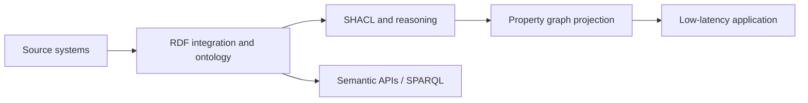

# RDF vs Property Graphs and Interoperability

> [!goal]
> Choose RDF, a property graph, a hybrid architecture, or no graph through explicit requirements rather than ideology.

## 1. The false binary

RDF and property graphs overlap, but they optimize different historical goals.

- RDF centers globally identified statements, Web interoperability, formal semantics and standards-based vocabulary reuse.
- Property graphs center application-friendly nodes/relationships with properties and efficient pattern/traversal workloads.

Both can represent many of the same domains. The important differences are statement identity, schema/semantics, edge properties, naming, query languages, ecosystem and operational behavior.

## 2. Comparison

| Dimension | RDF/OWL ecosystem | Labeled property graph ecosystem |
|---|---|---|
| Atomic fact | Triple/quad | Node, edge, property |
| Identity | IRIs, blank nodes, literals | Engine/application IDs and keys |
| Edge metadata | Named graph, reification, RDF-star/triple terms, event/assertion node | Native edge properties |
| Semantics | Formal RDF/RDFS/OWL entailment | Usually application-defined; schemas/constraints vary |
| Schema stance | Open-world vocabulary and axioms | Often pragmatic application schema |
| Query | SPARQL | Cypher/GQL/Gremlin and vendor dialects |
| Interchange | Strong Web standards | Improving through GQL and exchange formats |
| Validation | SHACL/ShEx | Product constraints/application validation |
| Typical strength | Integration, provenance, ontology, federation | Operational traversal, developer ergonomics, graph apps |

This table is directional, not absolute. RDF stores may be operationally fast, and property-graph systems can implement ontology-like layers.

## 3. Semantic differences that matter

### Open world versus closed-world application logic

OWL generally does not infer falsity from absence. An application database often treats missing required data as invalid. Use OWL for entailment and SHACL/application rules for validation.

### Unique-name assumptions

Different RDF IRIs are not automatically known to denote different things. Many property-graph applications assume business keys are distinct. Make identity policy explicit.

### Edge identity and qualification

A property-graph edge naturally carries properties. In RDF, qualify a statement with:

- an event/entity node;
- named graphs for context;
- standard reification patterns;
- provenance vocabularies;
- RDF 1.2 triple terms, while checking implementation support.

### Types

RDF permits multiple classes and class inference. Property-graph labels are usually operational tags, though modern graph type systems are becoming more formal. Do not assume they have OWL semantics.

## 4. Decision criteria

Choose RDF/OWL when the primary need includes several of:

- shared semantic contracts across organizations;
- globally stable identifiers;
- ontology-based integration and reasoning;
- standards-based linked data;
- rich provenance and named graphs;
- SPARQL federation;
- many independently governed data producers.

Choose a property graph when the primary need includes several of:

- application-centric traversals and graph pattern matching;
- relationship properties used heavily in queries;
- rapid developer iteration;
- operational graph workloads and graph algorithms in one ecosystem;
- a bounded organization/domain with controlled schema;
- strong fit with Cypher/GQL/Gremlin tooling.

Choose a hybrid when semantics and operational graph computation are independently valuable. Choose no graph when the workload is mostly flat aggregation, key-value lookup, document retrieval, or straightforward relational joins.

## 5. Hybrid patterns

### Pattern A: RDF as semantic source, property graph as serving projection

Define projection rules, provenance and refresh semantics. Never let the projection silently become a competing source of truth.

### Pattern B: Property graph source plus ontology mapping

Keep operational data in a property graph and maintain a semantic mapping/export for interoperability and reasoning.

### Pattern C: Logical dual access

A platform exposes both SPARQL and property-graph query views over shared storage. Validate whether semantics and transactions are actually consistent across views.

### Pattern D: Event-driven synchronization

Changes emit durable events consumed by each graph representation. Requires idempotency, ordering policy, reconciliation and observable lag.

## 6. Mapping challenges

- RDF predicates can be properties or edges depending on object type and query use.
- RDF permits multi-typing; LPG labels may map cleanly, but class expressions do not.
- Blank nodes need skolemization or deterministic IDs.
- RDF lists and containers need explicit structures.
- language-tagged strings and datatypes must be preserved.
- named-graph context does not map automatically to edge properties.
- OWL entailments may need materialization before projection.
- property-graph edge IDs and parallel edges require a mapping policy.

A mapping is not correct merely because all values moved. It is correct when specified questions and constraints remain semantically equivalent within declared limits.

## 7. Interoperability approaches

Relevant mechanisms include:

- RDF serializations and JSON-LD;
- R2RML/RML-style source mappings;
- RDF-star/RDF 1.2 triple terms for statement qualification;
- W3C work on RDF and property-graph interoperability;
- GQL for standardized property-graph language semantics;
- vendor import/export formats;
- custom mapping DSLs and ETL.

Pin specification versions. As of November 2026, major RDF 1.2 and SPARQL 1.2 documents remain on the W3C Recommendation track rather than all being final Recommendations. See [[48_Current_Standards_Status_2026]].

## 8. Evaluation framework

Score each candidate architecture from 1 to 5:

| Criterion | Weight | Questions |
|---|---:|---|
| Semantic interoperability |  | Are external vocabularies, reasoning and long-lived identifiers central? |
| Query workload |  | What are the top 20 queries and latency targets? |
| Update behavior |  | How frequent, transactional and concurrent are writes? |
| Provenance/context |  | Is statement-level evidence required? |
| Scale/topology |  | Nodes, edges, properties, degree skew, path depths? |
| Governance |  | Who owns schema and approves changes? |
| Operations |  | HA, backup, observability, skills and cost? |
| ML/analytics |  | Which algorithms, projections and feature flows are needed? |

Then build a small workload benchmark. Architecture by table alone is risky.

## 9. Worked example

For an enterprise dealer-coaching assistant:

- ontology: defines dealer, organization, role, program, observation, recommendation and evidence;
- RDF layer: integrates governed terms, policies, provenance and validity intervals;
- property graph: supports low-latency neighborhood retrieval, similarity, paths and graph algorithms;
- warehouse: remains authoritative for high-volume numeric facts;
- vector index: retrieves unstructured manuals;
- agent: selects sources, runs constrained tools and cites evidence.

This is not duplication without purpose. Each representation has a declared responsibility and reconciliation rule.

## 10. Laboratory

Represent the same domain in Turtle and Cypher. Implement ten competency questions in SPARQL and Cypher. For each, document:

- semantic equivalence;
- modeling friction;
- query readability;
- inference assumptions;
- provenance behavior;
- latency and plan;
- information lost during conversion.

Finish with an architecture decision record.

## Mastery checklist

- [ ] I can distinguish formal semantics from graph shape.
- [ ] I can explain open-world and identity consequences.
- [ ] I can choose a statement-qualification pattern.
- [ ] I can design and test an RDF-to-property-graph projection.
- [ ] I can reject graph technology when it adds no value.

## Sources and next reading

- [RDF 1.2 Concepts](https://www.w3.org/TR/rdf12-concepts/)
- [ISO GQL](https://www.iso.org/standard/76120.html)
- [W3C RDF and property graph interoperability work](https://www.w3.org/2021/12/rdf-star.html)
- [[15_KG_Construction_from_Structured_Data]]
- [[29_Knowledge_Graph_and_LLM_Integration]]
