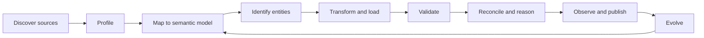

# KG Construction from Structured Data

> [!goal]
> Build a repeatable, provenance-aware pipeline that turns databases, warehouses, APIs and files into a governed knowledge graph.

## 1. Construction is a lifecycle

A production pipeline is not "convert rows to nodes." It includes:



Every output assertion should be explainable by a source, mapping version and transformation.

## 2. Source discovery and profiling

For each source collect:

- owner and authoritative scope;
- schema and change history;
- primary/business keys;
- update cadence and event-time semantics;
- null, duplicate and invalid rates;
- reference-code domains;
- units, currency, timezone and language;
- privacy/classification;
- row counts and growth;
- extraction interface and reliability.

Profile value distributions and relational constraints. Foreign keys may be missing or informational rather than enforced.

## 3. Canonical model versus source-shaped graph

A source-shaped graph mirrors tables. It is fast to produce but preserves legacy accidents. A canonical graph uses stable domain concepts and relations, improving integration but demanding governance.

Use layers:

1. **landing/raw**: immutable source snapshots/events;
2. **normalized**: cleaned datatypes and source keys;
3. **semantic integration**: canonical entities, relations, provenance;
4. **serving projections**: application-specific RDF/property graph/feature views.

Do not force every source detail into the core ontology. Preserve unmapped payloads when auditability requires them.

## 4. Mapping specification

For each target element record:

| Field | Meaning |
|---|---|
| Target term | Class/property/label/edge |
| Source expression | Table/column/JSONPath/SQL |
| Identifier template | Deterministic IRI or business key |
| Transform | Datatype, unit, code mapping |
| Join | How related source records connect |
| Condition | Inclusion/exclusion rule |
| Provenance | Source, record, batch and mapping version |
| Null policy | Omit, unknown node, error or default |
| Cardinality | Expected multiplicity |
| Test | Fixture and expected triples/nodes |

For RDF, R2RML maps relational data to RDF; RML-family approaches generalize mappings to other source forms. For property graphs, use explicit declarative mapping contracts even if implemented in SQL/Python.

## 5. Stable identity

A deterministic identifier function might be:

```python
from urllib.parse import quote

def dealer_iri(country: str, source_id: str) -> str:
    key = f"{country.strip().upper()}:{source_id.strip()}"
    return "https://example.org/id/dealer/" + quote(key, safe="")
```

Rules:

- never use mutable names as identity;
- namespace identifiers by authoritative system/domain;
- distinguish source record, real-world entity and account/profile;
- retain crosswalks and merge history;
- do not hash sensitive values without threat analysis;
- document whether identifiers may be recycled.

Entity resolution belongs in [[17_Entity_Resolution_and_Knowledge_Fusion]].

## 6. Time and events

Distinguish:

- event time: when the domain event occurred;
- valid time: when a fact holds in the world;
- transaction/ingestion time: when the system recorded it;
- processing time: when a pipeline handled it.

Represent changing relationships as events or validity-scoped assertions, not overwritten timeless edges.

```text
MembershipAssignment
  person -> Person
  organization -> Organization
  role -> Role
  validFrom -> instant
  validTo -> instant?
  assertedBy -> SourceRecord
```

## 7. Provenance

Minimum provenance for critical data:

- source system and record ID;
- extraction/batch ID;
- source event time;
- mapping/transformation version;
- generated entity/assertion ID;
- confidence if inferred;
- responsible agent/process;
- license and access policy where relevant.

Use W3C PROV concepts such as entity, activity and agent when RDF interoperability matters. A lighter internal model is acceptable if it preserves the same audit questions.

## 8. Incremental ingestion

Options:

- full snapshot diff;
- timestamp/watermark extraction;
- database change data capture;
- event streams;
- source-provided version feeds.

Handle late and out-of-order events. A watermark is not proof of completeness. Define delete semantics: hard delete, tombstone, end-dating or retraction.

### Idempotent load pseudocode

```python
for event in ordered_batch:
    key = canonical_key(event)
    if already_applied(event.event_id):
        continue
    validate_source_contract(event)
    upsert_entity(key, event.payload)
    record_provenance(key, event)
    mark_applied(event.event_id)
```

Exactly-once processing is often achieved as at-least-once delivery plus idempotent writes and deduplication.

## 9. Validation gates

Before publication:

- schema and datatype checks;
- business-key uniqueness;
- referential integrity;
- SHACL or equivalent graph constraints;
- ontology consistency where applicable;
- competency-query regression tests;
- source-to-graph count/reconciliation;
- sampled semantic review;
- provenance completeness;
- privacy/access checks.

Track quarantine separately from rejection. A bad record should not silently disappear.

## 10. Performance engineering

- bulk-load when possible, then enable expensive indexes/constraints as appropriate;
- batch bounded transaction sizes;
- parameterize queries;
- deduplicate before writes;
- precompute source crosswalks;
- use staging labels/graphs;
- keep transformation code deterministic;
- partition by source/time when it aids recovery;
- measure write amplification and index cost.

## 11. Data contracts and change

A source contract should specify schema, semantics, quality thresholds, ownership, compatibility and notification. Detect schema drift automatically, but require human review for semantic drift such as changed code meaning.

Version mappings and ontologies independently. A mapping release states compatible source schema and target ontology versions.

## 12. Laboratory

Ingest a PostgreSQL schema and two CSV/API sources into:

1. RDF using RDFLib or Apache Jena;
2. a property graph using Neo4j.

Required deliverables:

- source profile;
- mapping specification;
- deterministic identifiers;
- incremental load and delete policy;
- provenance model;
- SHACL/constraints;
- reconciliation report;
- rollback/replay test;
- ten competency queries.

## Mastery checklist

- [ ] I can separate raw, canonical and serving layers.
- [ ] Every critical assertion is traceable to source and mapping version.
- [ ] My load is replay-safe and handles deletions/late events.
- [ ] I distinguish event, valid and ingestion time.
- [ ] I test semantic correctness, not only row counts.

## Sources and next reading

- [W3C R2RML](https://www.w3.org/TR/r2rml/)
- [W3C PROV-O](https://www.w3.org/TR/prov-o/)
- [RDFLib documentation](https://rdflib.readthedocs.io/)
- [Apache Jena documentation](https://jena.apache.org/documentation/)
- [[16_KG_Construction_from_Text_and_Multimodal_Data]]
- [[18_KG_Quality_Governance_and_Evolution]]
