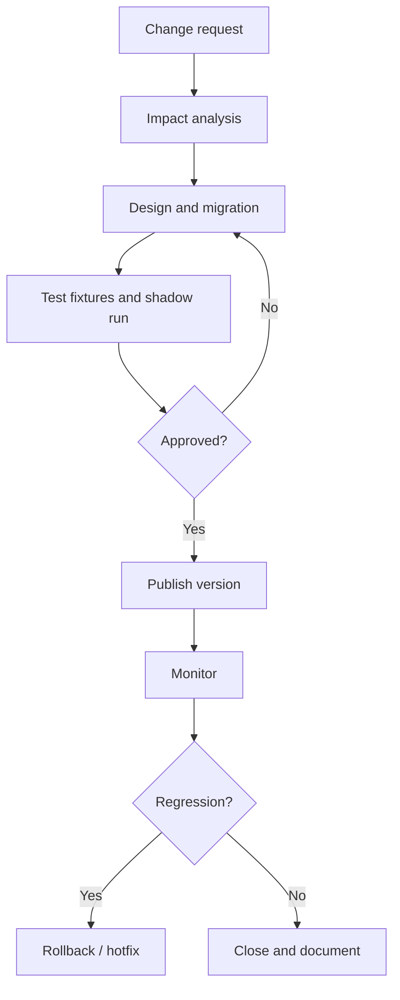

# KG Quality, Governance and Evolution

> [!goal]
> Operate a knowledge graph as a measurable, governed product whose meaning, data and interfaces can evolve safely.

## 1. Quality is fitness for use

A graph can be syntactically valid and still harmful. Evaluate quality against use cases.

Core dimensions:

- **accuracy**: assertions agree with trusted evidence;
- **completeness**: required entities/properties/relations are present under a declared boundary;
- **consistency**: no relevant logical or business contradictions;
- **timeliness**: current enough for the decision;
- **uniqueness/identity**: duplicates and false merges controlled;
- **validity**: conforms to syntax, datatype and constraints;
- **provenance**: evidence and transformation trace exist;
- **semantic clarity**: terms have stable definitions;
- **accessibility**: authorized users can query reliably;
- **fairness/coverage**: quality does not collapse for specific sources/groups.

Open-world completeness is never absolute. State a completeness claim such as "all active dealers in source S as of watermark T."

## 2. Quality rules at multiple layers

| Layer | Examples |
|---|---|
| Source contract | required columns, code domains, freshness |
| Mapping | identifier template, unit conversion, join cardinality |
| Graph syntax | valid IRIs, datatypes, labels |
| Structural shape | required properties, cardinality, class/type |
| Logical | consistency, expected entailments |
| Statistical | unusual degree, null, distribution drift |
| Domain | program interval, hierarchy, role rules |
| Application | competency-answer and latency tests |

Use SHACL or equivalent constraints, reasoners, SQL checks, graph anomaly tests and application tests together.

## 3. Metrics

Examples:

$$\text{provenance coverage}=\frac{\text{critical assertions with accepted provenance}}{\text{critical assertions}}$$

$$\text{freshness lag}=t_{available}-t_{source\ event}$$

$$\text{constraint failure rate}=\frac{\text{focus nodes failing}}{\text{focus nodes evaluated}}$$

Track distributions, not only averages: p95 freshness, failures by source/type, high-degree outliers and unresolved-identity queue age.

## 4. Governance roles

- domain owner: approves meaning and use;
- ontology steward: manages terms, axioms and reuse;
- data owner: accountable for source data;
- data steward: resolves quality issues;
- platform owner: availability, security and cost;
- pipeline owner: mappings and ingestion;
- model owner: extraction/ER/ML model lifecycle;
- consumer owner: defines competency and service requirements;
- governance council: adjudicates cross-domain changes.

A RACI matrix is more useful than a vague "data governance team."

## 5. Change types

### Ontology changes

- annotations only;
- additive term/axiom;
- deprecation;
- hierarchy or domain/range change;
- disjointness/restriction strengthening;
- identifier replacement;
- import/version change.

### Data changes

- assertion addition/retraction;
- corrected value;
- entity merge/split;
- backfill;
- source deletion;
- provenance correction.

### Interface changes

- query/API response;
- graph projection;
- access policy;
- latency/SLA;
- model feature contract.

Classify compatibility for each consumer, not globally.

## 6. Versioning

Version:

- ontology/schema;
- mapping/transformation;
- source snapshot/event offset;
- validation shapes;
- inference rules/reasoner;
- ER/extraction model;
- serving projection;
- query/API contract.

A reproducible answer includes all relevant versions plus as-of time.

Use semantic versioning cautiously: a logically stronger axiom can break data even if syntax is additive. Maintain machine-readable release notes and migration rules.

## 7. Evolution workflow

Impact analysis should find affected terms, shapes, mappings, data, queries, dashboards, features, prompts and agents.

## 8. Observability and lineage

Dashboards should cover:

- source ingestion status and lag;
- graph counts and growth;
- validation violations by severity/source;
- ontology consistency;
- ER merge/split/review rates;
- query latency/error/timeout;
- inference/materialization lag;
- GraphRAG retrieval and citation quality;
- access-denied and security events;
- cost.

Lineage must support forward impact (what depends on this source/term?) and backward trace (where did this answer come from?).

## 9. Security and privacy

Model authorization separately from taxonomy. Consider:

- graph-level, label/class, property, edge and row/entity access;
- inference leakage: hidden facts may be deduced from visible paths;
- path existence and count leakage;
- multi-tenant isolation;
- purpose limitation and consent;
- retention/right-to-delete;
- sensitive attributes inferred by embeddings;
- prompt/tool access in agent systems.

Redaction after retrieval may be too late. Enforce authorization in the graph/query layer and test inference channels.

## 10. Incident response

Incident classes:

- wrong mapping contaminates graph;
- accidental false entity merge;
- ontology change creates unexpected inference;
- source backfill duplicates data;
- unauthorized relationship exposed;
- stale graph drives recommendation;
- model extraction drift.

Maintain runbooks with detection, containment, affected-version discovery, rollback/rebuild, consumer notification and postmortem actions.

## 11. Quality gates for release

- [ ] Source contracts pass.
- [ ] Mapping tests and reconciliation pass.
- [ ] Critical SHACL/constraints have zero violations or approved waivers.
- [ ] Ontology is consistent and expected entailments pass.
- [ ] CQ regression is within tolerance.
- [ ] Security and privacy tests pass.
- [ ] Performance/capacity targets pass.
- [ ] Version, lineage and rollback artifacts exist.
- [ ] Consumer owners approve breaking changes.

## 12. Laboratory

Introduce controlled defects into a KG: duplicate entities, swapped units, stale values, invalid intervals, contradictory types, missing provenance and unauthorized edges. Build detectors, severity policy, quarantine, dashboards and an incident report. Then perform an ontology change with a shadow graph and regression comparison.

## Mastery checklist

- [ ] I define completeness relative to scope and time.
- [ ] Quality metrics are segmented by source/type and tied to decisions.
- [ ] Every semantic change has impact analysis and migration.
- [ ] I can reproduce an answer by versions and as-of time.
- [ ] Security tests include inference and path leakage.

## Next reading

- [[19_Temporal_Spatial_Probabilistic_and_Hyper_KGs]]
- [[33_Safety_Evaluation_and_Production_Operations]]
- [[39_Paper_Reading_Reproduction_and_Writing]]
