# Graph Data Science Workflows

> [!goal]
> Turn graph algorithms into reproducible decision systems through projection, baselines, evaluation, deployment and monitoring.

## 1. Problem framing

Start with an action, not an algorithm.

```text
Decision: Which dealers need a specific coaching intervention next week?
Prediction/analysis unit: dealer-week
Outcome: verified improvement or risk event
Decision time: Monday 08:00
Available evidence: only data timestamped before decision time
Graph contribution: peer structure, program/region relationships, prior interactions
Cost: false negative > false positive, but intervention capacity is limited
```

Ask whether a graph adds measurable value over tabular features. Always build a non-graph baseline.

## 2. Reproducible projection

An analytical projection specifies:

- source snapshot and as-of time;
- node sets and labels/types;
- relationship sets, direction and weights;
- feature columns and missing-value policy;
- filters and access scope;
- deduplication and self-loop policy;
- train/validation/test boundaries;
- projection code/version.

The projection is part of the model. A change to edge definition can matter more than a hyperparameter change.

## 3. Workflow

```mermaid
flowchart LR
    Q[Decision question] --> B[Baseline]
    B --> P[Graph projection]
    P --> E[Explore and validate]
    E --> A[Algorithms/features]
    A --> M[Model or ranking]
    M --> T[Leakage-safe evaluation]
    T --> X[Explain and stress-test]
    X --> D[Deploy]
    D --> O[Monitor and retrain]
```



## 4. Exploratory graph analysis

Before ML:

- inspect components, degree and edge-type distributions;
- find hubs, duplicates and accidental cliques;
- test temporal coverage;
- inspect labels by topology to detect leakage;
- examine train/test connectivity;
- visualize sampled ego networks, not the whole graph;
- check sensitive-group coverage.

A nearly perfect community-label correlation may be a real signal or direct label leakage from graph construction.

## 5. Graph algorithms as features

Potential features:

- degree/weighted degree by edge type;
- PageRank/personalized PageRank;
- k-core, triangle count, clustering coefficient;
- community membership and within-community degree;
- shortest distance to known risk/seed entities;
- motif counts;
- neighborhood label distributions computed only from past/training data;
- graph embeddings.

Compute features at the prediction timestamp. Global algorithms can leak future edges even if node labels are temporally split.

## 6. Algorithm pipelines

Neo4j GDS, for example, separates graph projection, algorithm execution, result streaming/mutation/writing and ML pipelines. Other stacks include NetworkX for smaller experiments, igraph/graph-tool, Spark/GraphFrames, GraphBLAS and custom sparse computation.

Conceptual Neo4j workflow:

```cypher
CALL gds.graph.project(
  'dealerGraph',
  ['Dealer','Program'],
  {PARTICIPATES_IN: {orientation:'UNDIRECTED'}}
);

CALL gds.pageRank.stream('dealerGraph')
YIELD nodeId, score
RETURN gds.util.asNode(nodeId).code AS dealer, score
ORDER BY score DESC;
```

Pin the product version and record configuration; algorithm defaults can change.

## 7. Train/validation/test design

Choose a split matching deployment:

- temporal split for future prediction;
- inductive split for unseen nodes/graphs;
- relation-disjoint split for unseen relation transfer;
- geographic/source split for domain generalization;
- grouped split preventing entity leakage.

Build the graph for each split using only allowed data. Do not create one full graph and merely hide target labels if future edges remain.

## 8. Baselines

At minimum:

1. majority/popularity heuristic;
2. tabular model using non-graph features;
3. simple structural heuristic;
4. shallow graph embedding or linear graph feature model;
5. proposed complex model.

A GNN that barely beats gradient boosting on degree and recency may not justify production complexity.

## 9. Evaluation tied to decisions

Classification metrics alone are insufficient. Include:

- precision/recall/PR-AUC for imbalanced outcomes;
- ranking metrics at intervention capacity: precision@k, recall@k, NDCG;
- calibration and selective risk;
- cost/utility under policy;
- subgroup/source performance;
- stability across time and graph perturbations;
- latency, throughput, memory and cost;
- explanation/evidence usefulness.

Use confidence intervals across seeds and time windows.

## 10. Explanations

Graph explanations may show:

- important neighbors/edges;
- influential paths;
- algorithmic features;
- counterfactual graph changes;
- ontology/rule evidence.

Distinguish model explanation from causal explanation. A path used by a model is not necessarily why an outcome occurred.

## 11. Production patterns

### Batch scoring

Daily/weekly graph snapshot -> feature/algorithm run -> score table -> downstream application. Simple, reproducible and often sufficient.

### Near-real-time serving

Incremental graph updates -> online neighborhood features/embeddings -> low-latency scorer. Harder consistency and feature freshness.

### Two-store pattern

Graph engine computes/serves relationships; feature store or warehouse serves time-aligned features. Maintain entity IDs and point-in-time joins.

## 12. Monitoring

Monitor:

- graph size, degree and component drift;
- new/unseen node and relation rates;
- feature/embedding drift;
- label and performance drift;
- calibration;
- algorithm convergence/runtime;
- data freshness and missingness;
- fairness and coverage;
- action outcomes and feedback loops.

Recommendations change behavior, which changes the graph. Treat this as a policy feedback loop, not ordinary IID retraining.

## 13. Experiment record

Every run should capture:

- source snapshot/checksum;
- graph projection definition;
- split generator and seed;
- code/commit/environment;
- algorithm/model configuration;
- hardware/runtime;
- metrics and uncertainty;
- artifacts and failure notes.

Use [[Template - Experiment Note]].

## 14. Laboratory

Create a churn/risk/link-prioritization pipeline. Compare:

- tabular baseline;
- hand-built graph features;
- Node2Vec-like embedding;
- GNN;
- hybrid model.

Use temporal splits and intervention-budget metrics. Deploy batch scoring with data/graph/model monitoring and a rollback plan.

## Mastery checklist

- [ ] The graph projection is versioned as part of the model.
- [ ] I build point-in-time-correct graphs and features.
- [ ] I compare against strong non-graph baselines.
- [ ] Evaluation reflects capacity, cost and unseen entities.
- [ ] Production monitoring includes topology and feedback loops.

## Sources and next reading

- [Neo4j Graph Data Science manual](https://neo4j.com/docs/graph-data-science/current/)
- [LDBC Graphalytics](https://ldbcouncil.org/benchmarks/graphalytics/)
- [[28_Graph_ML_Evaluation_Datasets_and_Benchmarks]]
- [[33_Safety_Evaluation_and_Production_Operations]]
