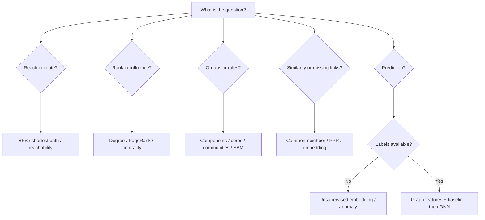

# Graph Algorithm Selection Guide

> [!goal]
> Select the simplest graph method that answers the actual question under the graph's semantics, scale and operational constraints.

## 1. First decision: is it a graph problem?

Use graph methods when relationships, multi-hop structure, topology or relational dependence are central. Prefer other structures when:

- independent row prediction dominates;
- queries are mainly aggregate filters and joins;
- full-text semantic retrieval is the need;
- time-series dynamics dominate with little relational signal;
- the graph is created only to force a fashionable method.

## 2. Selection tree

## 3. Question-to-method matrix

| Question | Start with | Escalate to | Common trap |
|---|---|---|---|
| Can A reach B? | BFS/DFS | regular path query | enumerating all paths |
| Cheapest route? | Dijkstra/A* | constrained shortest path | treating similarity as additive cost |
| Most locally connected? | degree/strength | type-aware degree | calling it influence |
| Globally prominent? | PageRank/eigenvector | personalized/multiplex ranking | ignoring direction and hubs |
| Structural broker? | bridges/articulation | betweenness/flow | shortest-path assumption |
| Cohesive core? | k-core | k-truss/dense subgraph | equating core with authority |
| Communities? | components/Leiden | SBM/Infomap/multilayer | one unstable partition as truth |
| Similar nodes? | attributes + Jaccard | PPR/embeddings/GNN | circular similarity graph |
| Predict an edge? | heuristics | KGE/GNN/temporal model | random negative leakage |
| Predict a node label? | tabular + degree | GraphSAGE/GAT/heterophily model | transductive test leakage |
| Detect anomaly? | rules/distributions | subgraph/embedding methods | no labeled/operational validation |
| Explain a recommendation? | paths/rules/evidence | model explainer + counterfactual | path as causal proof |

## 4. Graph characteristics that change the answer

### Direction

Do not symmetrize by habit. Incoming endorsement and outgoing activity differ.

### Weight

Clarify whether large means stronger, more frequent, more costly or less desirable. Shortest-path algorithms minimize, so strength often needs inversion/transformation.

### Sign

Positive and negative edges require signed-network methods. Treating both as unsigned destroys balance/antagonism information.

### Multiple edge types

Collapse only if types are semantically commensurate. Otherwise use relation-specific features, metapaths, heterogeneous GNNs or multilayer analysis.

### Multigraph

Parallel events may carry frequency and time. Aggregating them changes semantics.

### Temporal dynamics

Static aggregation can create paths that never existed at the same time. Use time-respecting paths and temporal splits.

### Bipartite structure

Projecting users-items or authors-papers creates dense artificial edges. Prefer bipartite algorithms or degree-corrected projection.

### Degree skew

Hubs dominate common-neighbor, random-walk and message-passing methods. Normalize, cap or model them explicitly.

## 5. Complexity and scale

Estimate:

- $n=|V|$, $m=|E|$;
- average/max degree;
- component sizes;
- path depth;
- number of iterations;
- memory per node/edge;
- communication across partitions;
- update frequency.

For a sparse graph, many linear algorithms are $O(n+m)$ per pass, but repeated iterations, neighborhood explosion and dense intermediate structures can dominate.

## 6. Recommended escalation ladder

1. deterministic query/rule;
2. simple structural statistic;
3. classical graph algorithm;
4. graph features in a conventional model;
5. shallow embedding;
6. GNN/KGE;
7. transformer/foundation model;
8. hybrid neural-symbolic system.

Move upward only when evaluation demonstrates value beyond added cost and risk.

## 7. Algorithm assumptions checklist

Before running an algorithm:

- [ ] Is the graph directed/weighted/signed/typed/temporal?
- [ ] Are missing edges truly absent or merely unobserved?
- [ ] What does a path mean?
- [ ] Are weights additive?
- [ ] Does the algorithm assume connectedness/nonnegative weights?
- [ ] Is the graph sampled or censored?
- [ ] Could labels/targets leak into edges?
- [ ] Is the output stable across seeds/perturbations?
- [ ] What baseline and null model apply?
- [ ] How will the output be acted upon?

## 8. Worked examples

### Dealer peer comparison

Question: find comparable dealers, not merely nearby ones.

Start with explicit attributes and business rules. Then test graph similarity from shared programs, vehicle lines, geography and customer mix. Avoid using future performance or the target coaching outcome in the similarity graph.

### Fraud rings

Start with deterministic shared-identifier patterns and connected components. Add temporal motifs and risk-weighted paths. Use GNNs only after constructing realistic labels, negative examples and entity-time splits.

### Research discovery

Use citation/co-authorship/topic graphs. Personalized PageRank from a seed set may be more interpretable than a generic embedding. Apply time cutoff so future citations do not influence historical recommendation evaluation.

## 9. Output contract

For every graph result return:

- algorithm/version/configuration;
- graph projection and as-of time;
- score/cluster/path;
- interpretation and non-interpretation;
- uncertainty/stability;
- provenance;
- operational threshold or next action.

## 10. Practice

For 20 real business/research questions, fill a one-page method card using [[47_Decision_Trees_for_Graph_Problems]]. Defend a simple baseline before proposing ML.

## Mastery checklist

- [ ] I can reject an unnecessary graph solution.
- [ ] I state graph and algorithm assumptions before execution.
- [ ] I follow an escalation ladder from rules to complex models.
- [ ] I account for direction, weight, types, time and sampling.
- [ ] I attach interpretation boundaries to every result.

## Next reading

- [[20_Network_Science_and_Graph_Analytics]]
- [[23_Knowledge_Graph_Embeddings_and_Link_Prediction]]
- [[24_Graph_Neural_Network_Foundations]]
- [[47_Decision_Trees_for_Graph_Problems]]
