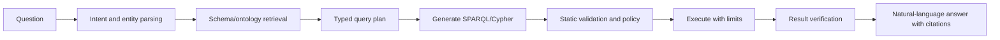
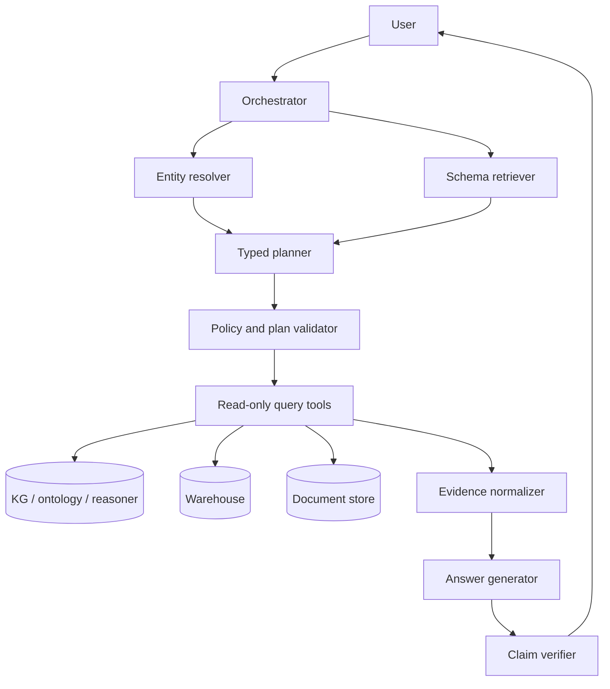

# Knowledge Graph and LLM Integration

> [!goal]
> Design systems in which language models and knowledge graphs compensate for each other's weaknesses without confusing fluent generation with verified reasoning.

## 1. Complementary strengths

Knowledge graphs provide explicit entities, relations, provenance, constraints and executable queries. LLMs provide language understanding, flexible extraction, planning and explanation. The integration space has four directions:

1. **LLM -> KG**: extraction, ontology suggestion, mapping, alignment and quality repair.
2. **KG -> LLM**: retrieval, grounding, constraints, examples and structured context.
3. **LLM <-> KG tools**: an agent plans queries, executes graph tools and interprets results.
4. **Joint models**: graph encoders and language models are trained/aligned together.

Keep a typed interface between components. A free-form prompt is not a data contract.

## 2. Questions a KG can answer

Classify the query before selecting architecture:

- direct fact lookup;
- aggregation;
- multi-hop path reasoning;
- temporal/as-of query;
- ontology/class reasoning;
- explanation/provenance;
- corpus-wide synthesis;
- hypothesis or recommendation;
- open-ended text generation.

A deterministic SPARQL/Cypher query is preferable for exact aggregation. Retrieval plus generation is appropriate when evidence must be synthesized. A reasoner is needed for formal entailment. ML is needed for uncertain completion or ranking.

## 3. Natural-language-to-query

Pipeline:



### Critical controls

- expose only relevant schema fragments;
- resolve entities separately from query generation;
- generate an intermediate typed plan;
- parse query AST, not regex-check text;
- allowlist operations and predicates/labels;
- force read-only transactions for QA;
- bound path length, result size, time and cost;
- validate result shape;
- show query and evidence for review when appropriate.

### Intermediate plan example

```json
{
  "intent": "compare_sales",
  "entities": [{"type": "Dealer", "id": "dealer:US:123"}],
  "measures": ["retail_units"],
  "group_by": ["month"],
  "time_range": {"from": "2026-01-01", "to": "2026-10-31"},
  "scope": "authorized_user_scope"
}
```

This can be validated before translating to SQL/SPARQL/Cypher.

## 4. Schema grounding

Large schemas overwhelm prompts. Retrieve a schema subgraph using:

- detected entity and relation names;
- ontology labels, definitions and aliases;
- domain/range and path connectivity;
- prior successful queries;
- access permissions;
- competency-question templates.

Return definitions and counterexamples, not names alone. `hasProgram` may mean enrollment, eligibility or active participation; only the ontology/data contract can disambiguate.

## 5. Entity linking

Resolve mentions to canonical IDs before graph query. Use candidate generation from aliases/text/vector indexes followed by type/context/temporal ranking. Preserve ambiguity:

```text
"Jaguar" -> vehicle brand (0.62), animal species (0.31), sports team (0.07)
```

Ask for clarification only when ambiguity materially changes the answer and cannot be resolved from context. In automated workflows, abstain or return alternatives rather than silently selecting.

## 6. Context construction

Possible graph context:

- triples or compact edge lists;
- paths with provenance;
- tables from exact queries;
- ontology definitions and constraints;
- subgraph summaries;
- proof traces;
- source document excerpts linked to graph claims.

Do not serialize a huge ego network directly. Rank by query relevance, evidence quality, time validity, authorization and diversity. Keep IDs for traceability while presenting readable labels.

## 7. LLM-assisted KG construction

LLMs can propose:

- entity/relation mentions;
- ontology term mappings;
- candidate classes/definitions;
- SHACL shapes from data contracts;
- query/test examples;
- conflict summaries.

Every proposal passes deterministic schema, provenance and validation gates. Use a candidate graph before promotion to the governed KG.

## 8. Ontology alignment with LLMs

LLMs can use labels/descriptions/examples to suggest correspondences. Risks include false equivalence and granularity mismatch. Classify mappings as:

- exact equivalence;
- broader/narrower;
- related but not equivalent;
- transformation rule;
- no mapping/uncertain.

Check logical coherence and instance evidence. A linguistic synonym does not guarantee ontological equivalence.

## 9. Structured generation and constrained decoding

Use JSON Schema, Pydantic or grammar constraints for plans and extraction. Validate:

- syntax;
- schema/version;
- ontology term existence;
- type compatibility;
- cardinality;
- permissions;
- temporal consistency.

Retry with explicit validation errors, then abstain after a limit. Never execute arbitrary generated code/query without a policy layer.

## 10. Answer grounding

An answer should separate:

- graph-derived facts;
- document-derived claims;
- model inference/interpretation;
- uncertainty and missing data.

A claim-level citation maps each sentence or atomic claim to query rows, graph assertions/provenance or document spans. A list of sources at the end is weaker than claim-evidence alignment.

## 11. Evaluation

### Query generation

- exact/execution match;
- result-set match;
- semantic equivalence;
- invalid/dangerous query rate;
- latency and retries;
- performance by query complexity.

### QA

- answer correctness/completeness;
- faithfulness to retrieved graph/doc evidence;
- citation precision/recall;
- ontology/type consistency;
- abstention quality;
- robustness to aliases, schema renaming and missing facts.

### Construction/alignment

- extraction/linking/mapping P/R/F1;
- logical consistency;
- constraint violation;
- expert review burden;
- downstream CQ improvement.

## 12. Recommended architecture



Use the graph as one source among authoritative systems. High-volume measures may remain in a warehouse; documents preserve detailed evidence.

## 13. Laboratory

Build a KGQA assistant over an ontology, graph and document collection. Support exact lookup, aggregation, multi-hop and explanation. Required:

- schema-subgraph retrieval;
- entity resolution;
- typed intermediate plans;
- read-only SPARQL/Cypher tools;
- policy limits;
- claim-level citations;
- gold test set with adversarial aliases and unauthorized queries;
- failure taxonomy.

## Mastery checklist

- [ ] I route exact queries, inference, retrieval and prediction to different components.
- [ ] Generated queries pass AST/schema/policy validation.
- [ ] Entity linking and schema retrieval are explicit stages.
- [ ] Answers distinguish evidence from model interpretation.
- [ ] I evaluate result semantics and citation faithfulness, not wording alone.

## Sources and next reading

- [[30_GraphRAG_and_Hybrid_Retrieval]]
- [[31_Ontology_Grounded_Agents]]
- [Knowledge Graphs and LLMs survey search](https://arxiv.org/search/?query=knowledge+graphs+large+language+models+survey&searchtype=all)
- [OntGQA, ACL 2026](https://aclanthology.org/2026.acl-long.489/)
