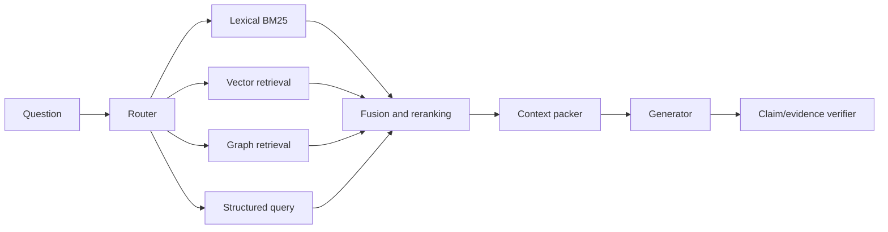

# GraphRAG and Hybrid Retrieval

> [!goal]
> Know when graph structure improves retrieval, how GraphRAG pipelines fail, and how to compare them fairly with vector, lexical and SQL/query baselines.

## 1. GraphRAG is a family, not one algorithm

GraphRAG means retrieval-augmented generation in which a graph influences indexing, retrieval, reasoning, context assembly or memory. The graph may be:

- an existing curated KG;
- an LLM-extracted entity-relation graph;
- a citation/metadata graph;
- a chunk/entity index graph;
- a community hierarchy;
- a document discourse graph;
- a user/session memory graph.

Always describe graph construction, retrieval operation and evidence mapping.

## 2. When graphs may help

- multi-hop facts distributed across documents;
- entity-centric neighborhoods;
- relation/type constraints;
- global themes or corpus-wide synthesis;
- provenance/path explanations;
- temporal/dependency reasoning;
- query expansion through controlled vocabulary;
- combining structured and unstructured sources.

Graphs often do **not** help simple fact lookup where strong lexical/vector retrieval already finds the passage. ICLR 2026's GraphRAG-Bench work explicitly studies when graph approaches outperform or underperform vanilla RAG.

## 3. Retrieval architecture

Hybrid retrieval is usually safer than replacing every retriever with a graph.

## 4. Graph construction choices

### Existing domain KG

Highest semantic control; coverage may be limited. Link text passages to entities and assertions.

### Extracted KG

Flexible over private corpora, but extraction and entity resolution errors create false paths. Preserve evidence spans and confidence.

### Index graph

Nodes are chunks/topics/summaries; edges encode similarity, hierarchy or references. Easier to construct but may not deserve the semantic guarantees associated with a KG.

### Community hierarchy

Cluster entity graph and summarize communities. Useful for corpus-level questions, but summaries can compound hallucination and lose minority facts.

## 5. Microsoft's GraphRAG pattern

The Microsoft research pipeline extracts entities, relationships and claims from text units; applies Leiden hierarchical community detection; generates community summaries; and exposes local, global, DRIFT and basic search modes.

Important operational notes from the project documentation/repository:

- indexing can be expensive;
- prompts require domain tuning;
- migration/versioning matters;
- the open-source repository is a research demonstration and is largely in maintenance mode as of 2026, not an officially supported product.

Study it as a design pattern, not the definition of GraphRAG.

## 6. Retrieval patterns

### Entity neighborhood

Link query entities, expand bounded typed edges, retrieve linked text evidence, rerank.

### Path retrieval

Find paths connecting entities or question constraints. Score by type validity, path length, edge confidence, recency and evidence coverage. Avoid presenting an arbitrary path as proof.

### Personalized PageRank

Seed query concepts and diffuse relevance. HippoRAG/HippoRAG 2 use graph-based associative retrieval with personalized PageRank-inspired mechanisms and passage integration.

### Community/global search

Retrieve community summaries for broad questions, then drill down to source evidence. Never cite only generated summaries when source passages exist.

### Subgraph retrieval with learned models

Train a retriever to select nodes/edges/subgraphs. Requires labeled relevance and careful negative sampling; can outperform rules but reduces interpretability.

## 7. Fusion and context packing

Candidate evidence has different score scales. Fusion methods:

- reciprocal rank fusion;
- normalized weighted sums;
- learned reranking;
- coverage/novelty-aware selection;
- graph-constrained diversification.

Context packing should maximize answer-relevant evidence under token budget while preserving source identifiers and relation structure. Include the minimal subgraph plus source passages, not graph triples without textual grounding when extraction is uncertain.

## 8. GraphRAG failure modes

- extraction hallucinations become graph edges;
- entity resolution merges unrelated entities;
- high-degree generic nodes dominate retrieval;
- community summaries omit exceptions;
- multi-hop expansion creates irrelevant context;
- source time/provenance is lost;
- graph is stale while documents change;
- answer cites a path but not source evidence;
- graph indexing cost outweighs query benefit;
- benchmark questions align artificially with graph construction;
- prompt injection enters graph metadata or retrieved text.

## 9. Evaluation by stage

### Construction

Entity/relation/event accuracy, linking, provenance coverage, graph quality and update cost.

### Retrieval

Recall@K, precision@K, NDCG, path/evidence recall, diversity, temporal validity and latency. Use claim-level gold evidence where possible.

### Generation

Correctness, completeness, faithfulness, citation quality, abstention and style.

### End-to-end

Task utility, cost, p95 latency, index/update time, robustness and human trust.

A graph method can improve final answers while retrieval metrics fall, or retrieve correct evidence while the generator ignores it. Measure both.

## 10. Fair baseline suite

Compare:

1. BM25;
2. dense vector retrieval;
3. BM25 + vector fusion;
4. long-context baseline where feasible;
5. structured query over an existing KG;
6. simple entity-linked neighborhood retrieval;
7. proposed GraphRAG;
8. oracle evidence upper bound.

Keep generator, prompts and token budgets controlled. Report indexing cost separately.

## 11. Decision guide

| Query/data condition | Recommended start |
|---|---|
| Exact structured fact/aggregate | SQL/SPARQL/Cypher |
| Single-document factual lookup | lexical + vector |
| Known entities with multi-hop relations | KG neighborhood/path + text |
| Broad corpus themes | hierarchical/community summaries + evidence drill-down |
| Associative retrieval across documents | entity graph/PPR hybrid |
| Weak extraction quality | vector/lexical first; graph only from trusted metadata |
| Highly dynamic corpus | incremental lightweight graph or query-time linking |

## 12. Laboratory

Build a benchmark with four question types: fact, multi-hop, global synthesis and temporal. Implement BM25, vector, hybrid, entity-neighborhood GraphRAG and community GraphRAG. Measure stage-level accuracy, end-to-end faithfulness, index/query cost and latency. Perform ablations for graph construction, entity linking, path depth and summaries.

## Mastery checklist

- [ ] I can name the graph, how it was built and how it retrieves.
- [ ] GraphRAG is compared with strong hybrid baselines.
- [ ] Generated graph assertions remain linked to source spans.
- [ ] I measure construction, retrieval and generation separately.
- [ ] The router can choose no-graph retrieval for simple questions.

## Sources and next reading

- [Microsoft GraphRAG documentation](https://microsoft.github.io/graphrag/)
- [Microsoft GraphRAG repository](https://github.com/microsoft/graphrag)
- [HippoRAG repository and papers](https://github.com/OSU-NLP-Group/HippoRAG)
- [When to use Graphs in RAG, ICLR 2026](https://proceedings.iclr.cc/paper_files/paper/2026/hash/6c9e01d6cefbbf4cdd265032550e767f-Abstract-Conference.html)
- [Graph-Assisted LLMs survey, ACL Findings 2026](https://aclanthology.org/2026.findings-acl.945/)
- [[33_Safety_Evaluation_and_Production_Operations]]
