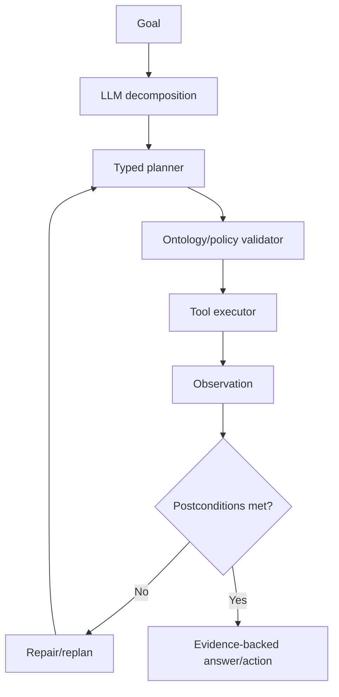

# Ontology-Grounded Agents

> [!goal]
> Use an ontology as an executable contract for agent perception, planning, tool selection, validation and explanation rather than as decorative metadata.

## 1. What grounding means

An ontology-grounded agent uses explicit domain types, relations, constraints, policies and action schemas to control behavior. Grounding can occur at:

- **interpretation**: map language to canonical entities/intents;
- **planning**: construct typed goals and preconditions;
- **tool selection**: match required inputs/outputs/capabilities;
- **execution**: validate parameters and state transitions;
- **memory**: store events, beliefs and artifacts consistently;
- **verification**: check results, policy and logical constraints;
- **explanation**: name concepts and evidence precisely.

A prompt containing an ontology excerpt is weaker than a system that validates every plan/action against it.

## 2. Agent state model

Separate:

- world facts from authoritative tools;
- observations returned in this run;
- beliefs/hypotheses with confidence;
- user goals and constraints;
- plan and execution state;
- permissions and scope;
- artifacts/provenance;
- unresolved questions.

```text
Observation != Belief != AssertedFact != DerivedFact != ProposedAction
```

This prevents an LLM suggestion from silently becoming graph truth.

## 3. Typed action schema

```yaml
action: get_dealer_sales
inputs:
  dealer: DealerID
  from_date: Date
  to_date: Date
preconditions:
  - userCanView(user, dealer)
  - from_date < to_date
outputs:
  observations: list[SalesObservation]
effects:
  - addsObservationToRunContext
side_effects: none
cost_class: medium
```

For write actions add approval, idempotency key, compensation and postcondition checks.

## 4. Planning

### LLM planning

Flexible but may invent actions/preconditions.

### Classical symbolic planning

Actions have preconditions/effects; search yields a valid plan under the modeled world. Reliable but modeling-intensive and brittle under uncertainty.

### Hybrid planning

LLM proposes goals/decomposition; symbolic/typed planner validates and searches; executor observes; replanner updates. This is often the strongest architecture.



## 5. Tool ontology

Represent tools by:

- capability/intention;
- input/output types;
- required scope/authorization;
- preconditions;
- side effects;
- cost/latency;
- reliability/freshness;
- rate limits;
- failure modes;
- compensation action;
- owner/version.

Tool selection becomes semantic matchmaking rather than name similarity alone.

## 6. Type-constrained reasoning

Ontology domain/range and path types reduce search. OntGQA (ACL 2026) demonstrates a planner-judge approach over a relation-centric ontology graph with endpoint type constraints for KG question answering. General lesson: constrain candidate paths by intended source/target types and validate them before generative fallback.

Type correctness is necessary, not sufficient. A semantically valid path can be irrelevant or temporally invalid.

## 7. Policy and authorization

Model policy separately but connect it to domain concepts:

- user role and organization scope;
- resource sensitivity;
- purpose of use;
- permitted action;
- data residency/time constraints;
- approval requirements.

Evaluate policy before retrieval and execution, not only before answer display. Otherwise hidden data can influence the output.

## 8. Agentic write safety

For graph updates or external actions:

1. generate a proposed change set;
2. validate schema, constraints and authorization;
3. show human-readable diff for high-impact actions;
4. obtain approval where required;
5. execute with idempotency key;
6. verify postconditions;
7. record provenance and audit event;
8. compensate/rollback on failure.

Never grant the same unconstrained query tool read and write privileges.

## 9. Ontology evolution and agents

Agents depend on term and tool versions. A renamed/deprecated property can break plans silently. Include:

- schema version in prompts/contracts;
- compatibility mappings;
- plan regression tests;
- deprecation warnings;
- capability discovery at runtime;
- shadow testing before ontology releases.

## 10. Explanation

An agent explanation should include:

- interpreted goal;
- relevant definitions/constraints;
- tools and parameters used;
- observations and timestamps;
- derivation/query/path;
- uncertainty and missing evidence;
- action outcome.

Do not expose hidden reasoning text; provide an auditable execution summary and proof/evidence objects.

## 11. Evaluation

- task success and partial success;
- plan validity before execution;
- type/constraint violation rate;
- tool selection and parameter accuracy;
- unauthorized-action rate;
- recovery from tool failure/stale data;
- steps, latency and cost;
- evidence/provenance completeness;
- explanation faithfulness;
- ontology-version robustness.

Create adversarial tests for alias ambiguity, impossible goals, conflicting constraints, prompt injection and privilege escalation.

## 12. Laboratory

Build a dealer-coaching or legal-research agent with:

- OWL/RDFS domain ontology;
- SHACL input/output validation;
- tool ontology and typed registry;
- read-only data tools plus one approval-gated write tool;
- plan validator;
- policy engine;
- provenance graph;
- 100 scenario test suite including failures and attacks.

Compare prompt-only, typed-tool and ontology-grounded versions.

## Mastery checklist

- [ ] Ontology terms constrain plans and tool I/O at runtime.
- [ ] Facts, observations, beliefs and proposals are separate states.
- [ ] Authorization is checked before data/tool access.
- [ ] Write actions have approval, idempotency and verification.
- [ ] Explanations come from execution/evidence traces.

## Sources and next reading

- [OntGQA, ACL 2026](https://aclanthology.org/2026.acl-long.489/)
- [OG-RAG, Microsoft Research 2025](https://www.microsoft.com/en-us/research/publication/og-rag-ontology-grounded-retrieval-augmented-generation-for-large-language-models/)
- [[32_Graph_Memory_Planning_and_Multi_Agent_Systems]]
- [[33_Safety_Evaluation_and_Production_Operations]]
