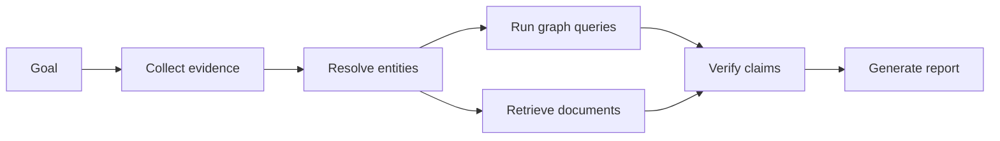

# Graph Memory, Planning and Multi-Agent Systems

> [!goal]
> Build persistent agent memory and coordination graphs that remain temporally valid, permission-aware, compact and correctable.

## 1. Memory is not one store

Separate:

- **working memory**: current task context;
- **episodic memory**: timestamped interactions/events;
- **semantic memory**: consolidated entities, facts and concepts;
- **procedural memory**: skills, policies and successful plans;
- **artifact memory**: documents, code, reports and outputs;
- **social/agent memory**: capabilities, commitments and trust.

A graph connects these memories, while vector indexes retrieve semantically similar content and logs preserve exact events.

## 2. Memory graph schema

```text
Episode --occurredAt--> Time
Episode --involved--> Agent/User/Tool
Episode --pursuedGoal--> Goal
Episode --usedPlan--> Plan
ToolCall --returned--> Observation
Observation --supports/contradicts--> Claim
Claim --about--> Entity
Claim --hasStatus--> Proposed/Verified/Rejected/Superseded
Artifact --generatedBy--> Activity
```

Keep original episode logs immutable. Consolidated semantic facts point back to episodes/evidence.

## 3. Write policy

Not every conversation sentence deserves persistent memory. Decide using:

- user consent and scope;
- long-term utility;
- sensitivity;
- confidence/verification;
- duplication;
- retention policy;
- correction/deletion requirements.

A memory write is an action subject to schema, privacy and provenance validation.

## 4. Consolidation

Episodic events can be summarized into semantic memory when repeated or verified. Consolidation pipeline:

1. identify candidate claims/entities;
2. entity resolution;
3. compare with current beliefs;
4. detect contradiction/temporal update;
5. assign status and provenance;
6. human review for sensitive/high-impact facts;
7. store and index;
8. schedule expiration/revalidation.

Do not overwrite "user works at X" when a later episode says Y; end-date or supersede the old assertion.

## 5. Retrieval

Retrieve by a mixture of:

- semantic similarity;
- entity/relationship neighborhood;
- recency and validity;
- goal relevance;
- source trust/verification;
- importance;
- access permission;
- diversity.

A memory score can be a reranking feature, but its terms need calibration. High emotional or model-generated salience should not override privacy or truth.

## 6. Forgetting and correction

Support:

- expiration/TTL;
- supersession;
- user correction;
- source retraction;
- privacy deletion;
- confidence decay;
- compaction of redundant episodes;
- rebuild of derived indexes/embeddings.

Deletion must propagate to vector indexes, caches, graph projections and model features. Preserve only the legally/permissibly required audit trace.

## 7. Planning graphs

Represent a plan as tasks with dependencies, resources, preconditions and outcomes:



A DAG supports parallel execution. Cycles indicate iteration/retry and need explicit bounds.

Planning can use:

- task networks/workflow graphs;
- classical state-space planning;
- AND/OR graphs;
- Monte Carlo tree search;
- graph search over tool states;
- LLM-generated dependency plans with validators.

## 8. Multi-agent coordination graph

Nodes may be agents, tasks, tools, artifacts and messages. Edges capture delegation, dependency, review and communication.

Common topologies:

- supervisor-worker star;
- pipeline;
- hierarchical organization;
- peer debate;
- blackboard/shared graph;
- dynamic capability routing.

More agents do not imply better reasoning. They add communication cost, correlated errors and harder accountability.

## 9. Capability and trust model

Each agent has:

- declared capabilities and versions;
- tool permissions;
- reliability by task type;
- cost/latency;
- data access scope;
- recent failures;
- conflict-of-interest/separation-of-duty rules.

Routing can optimize expected utility. Trust should be learned from verified outcomes, not persuasive language.

## 10. Coordination safety

- least privilege per agent;
- signed/typed messages;
- immutable task and tool logs;
- bounded delegation depth;
- no capability escalation through another agent;
- separation of proposer, executor and verifier for high-impact actions;
- loop/deadlock detection;
- budget and timeout controls;
- shared-graph transaction/version policy.

Prompt injection can propagate through messages and memory. Treat all retrieved/user/agent content as untrusted data, not instructions.

## 11. Evaluation

Memory:

- retrieval precision/recall for needed facts;
- temporal validity;
- contradiction and stale-memory rate;
- privacy/deletion compliance;
- storage/index cost;
- downstream task improvement.

Planning:

- valid plan rate;
- task success;
- redundant/failed steps;
- recovery and replanning;
- critical path and latency;
- cost.

Multi-agent:

- gain over best single-agent baseline;
- communication/token cost;
- error amplification/correction;
- delegation correctness;
- accountability and audit completeness.

## 12. Laboratory

Build a research agent team:

- planner;
- ontology/KG specialist;
- paper retriever;
- experiment runner;
- verifier/editor.

Use a graph for tasks, artifacts, claims and provenance. Add episodic and semantic memory with correction/deletion. Compare single-agent, fixed pipeline and dynamic multi-agent versions on 30 research tasks. Include prompt-injection and stale-memory tests.

## Mastery checklist

- [ ] Memory types and claim statuses are separate.
- [ ] Persistent writes require consent, provenance and policy.
- [ ] Temporal updates supersede rather than silently overwrite.
- [ ] Multi-agent systems are compared to a single-agent baseline.
- [ ] Delegation, budgets, privileges and loops are controlled.

## Next reading

- [HippoRAG 2](https://github.com/OSU-NLP-Group/HippoRAG)
- [[31_Ontology_Grounded_Agents]]
- [[33_Safety_Evaluation_and_Production_Operations]]
- [[37_Portfolio_and_Research_Projects]]
