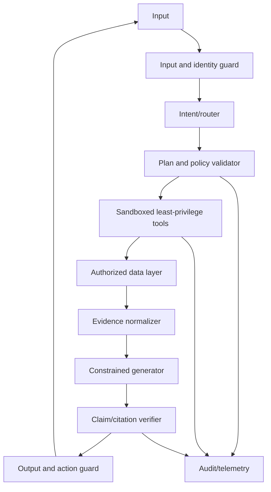

# Safety, Evaluation and Production Operations

> [!goal]
> Operate KG/GraphRAG/agent systems with measurable correctness, access control, attack resistance, observability and reversible change.

## 1. Threat model first

Assets:

- graph data and hidden relationships;
- ontology/policy definitions;
- credentials and tool permissions;
- user memory;
- proprietary documents;
- model prompts/configuration;
- derived recommendations/actions;
- audit trails.

Adversaries/failures:

- malicious user;
- poisoned source/document;
- prompt injection;
- compromised tool or dependency;
- insider misuse;
- accidental schema/mapping error;
- stale/incomplete data;
- model hallucination;
- entity-resolution contamination;
- denial of service through expensive graph queries.

## 2. Defense in depth

No single prompt can provide these guarantees.

## 3. Graph-specific security

### Inference leakage

Visible facts can reveal hidden facts through paths, counts, ontology inference or embeddings. Test queries that infer sensitive group membership, hierarchy or relationships.

### Query denial of service

Unbounded path enumeration, Cartesian patterns and broad federation can exhaust resources. Enforce query AST policies, path limits, timeouts, quotas and result caps.

### Graph poisoning

Injected nodes/edges can manipulate centrality, retrieval, recommendations or GNNs. Validate sources, provenance, anomaly signals and trust. Separate candidate from verified graph.

### Identity attacks

Alias manipulation can cause false entity merges. Require stronger evidence for high-impact merges and preserve reversibility.

## 4. Prompt injection in graph systems

Malicious instructions can appear in document text, labels, comments, memory or tool output. Treat retrieved content as data. Controls:

- isolate system/tool instructions from content;
- strip or encode active markup where safe;
- never let retrieved text change tool permissions;
- structured tool APIs rather than command strings;
- allowlisted plans and query ASTs;
- instruction hierarchy and provenance labels;
- detector plus adversarial tests;
- human approval for side effects.

## 5. Evaluation hierarchy

### Component tests

Extraction, entity linking, query generation, retrieval, reasoning, citations, policy and tool calls.

### Scenario tests

End-to-end representative tasks with expected outcomes and partial-credit rubrics.

### Adversarial tests

Prompt injection, schema ambiguity, stale facts, contradictory sources, unauthorized scope, expensive queries, malformed tool outputs and poisoned edges.

### Online evaluation

Shadow mode, canary release, user feedback, audited samples, incident metrics and outcome measurement.

## 6. Gold test set design

Include:

- simple, multi-hop, aggregate, temporal and global questions;
- answerable and unanswerable cases;
- ambiguous aliases;
- missing/inconsistent data;
- policy-denied questions;
- rare relation/types;
- source conflicts;
- expected citations/proof;
- counterfactual changes after graph updates.

Version the gold set with the ontology/data snapshot.

## 7. Metrics

| Layer | Metrics |
|---|---|
| Extraction/KG | P/R/F1, linking, validation, provenance coverage |
| Retrieval | evidence recall/precision, NDCG, path validity, diversity |
| Query | execution/result match, unsafe-query rate, latency |
| Answer | correctness, completeness, faithfulness, citation P/R |
| Agent | success, plan/tool accuracy, invalid action, recovery |
| Safety | unauthorized disclosure/action, injection success, abstention |
| Operations | p50/p95 latency, availability, cost, freshness, error budget |

For high-stakes decisions, measure selective risk: accuracy/coverage as the system abstains at different confidence thresholds.

## 8. Faithfulness verification

Break an answer into atomic claims. For each claim:

1. identify supporting evidence IDs;
2. verify the evidence entails or adequately supports the claim;
3. check time/scope/provenance;
4. detect unsupported additions;
5. mark contradiction/uncertainty;
6. revise or abstain.

LLM-as-judge can assist but must be calibrated against human labels and deterministic checks. It shares model biases and may accept plausible unsupported claims.

## 9. Observability

Trace one request across:

- authenticated user/scope;
- prompt and schema versions;
- entity candidates/resolution;
- plan and validations;
- tool/query calls, parameters and plans;
- graph/document snapshot;
- retrieved evidence;
- model/version/temperature;
- final claims/citations;
- policy decisions;
- latency/cost/error.

Protect logs from sensitive data. Use IDs and controlled replay environments.

## 10. Deployment

- offline regression before release;
- shadow traffic;
- small canary by user/task;
- automatic rollback thresholds;
- feature flags per retriever/tool/model;
- pinned versions and reproducible builds;
- graceful degradation to read-only/search or deterministic query;
- circuit breakers for model/tool/database failure;
- rate limiting and budget controls.

## 11. Change management

A change to ontology, mapping, graph data, embedding model, extraction prompt, retriever or LLM can alter answers. Maintain a dependency manifest and run targeted regression. For graph rebuilds, use blue/green snapshots and compare key metrics/queries before switching.

## 12. Incident response

Example incident: false merge causes confidential customer evidence to appear in another account.

1. disable affected path/tool;
2. identify merge decision and derived artifacts;
3. split entity and rebuild projections/indexes;
4. find exposed requests/users;
5. notify owners according to policy;
6. add cannot-link/validation and regression cases;
7. document root cause and recovery.

## 13. Cost engineering

Track:

- extraction/indexing tokens;
- graph storage and duplicate projections;
- query and vector search cost;
- generation/verifier calls;
- human review;
- re-index after schema/model changes.

Cache only when authorization, snapshot and temporal context are part of the key. Generated community summaries can become expensive stale artifacts.

## 14. Production readiness checklist

- [ ] Threat model and data classification exist.
- [ ] All tools are least-privilege and typed.
- [ ] Read/write paths are separated.
- [ ] Query/path/cost bounds are enforced outside the LLM.
- [ ] Evidence and provenance survive retrieval/generation.
- [ ] Gold, adversarial and policy tests run in CI.
- [ ] Graph/model/schema versions are traceable.
- [ ] Canary, rollback and graceful-degradation paths work.
- [ ] Deletion/correction propagates to all indexes and memories.
- [ ] Incidents have owners and runbooks.

## 15. Laboratory

Take the system from [[31_Ontology_Grounded_Agents]]. Add 50 adversarial tests, policy-denied scenarios, query cost guards, claim verifier, traces, dashboards, canary simulation and an incident drill. Measure safety/quality before and after each defense, including false positives and latency cost.

## Mastery checklist

- [ ] I can state assets, attackers and high-impact failure modes.
- [ ] Authorization happens before retrieval and execution.
- [ ] Every final claim is traceable to time-valid evidence.
- [ ] Changes are canaried, monitored and reversible.
- [ ] Safety controls are evaluated, not merely described.

## Sources and next reading

- [OWASP Top 10 for LLM Applications](https://owasp.org/www-project-top-10-for-large-language-model-applications/)
- [NIST AI Risk Management Framework](https://www.nist.gov/itl/ai-risk-management-framework)
- [GraphRAG-Bench, ICLR 2026](https://proceedings.iclr.cc/paper_files/paper/2026/hash/6c9e01d6cefbbf4cdd265032550e767f-Abstract-Conference.html)
- [[18_KG_Quality_Governance_and_Evolution]]
- [[39_Paper_Reading_Reproduction_and_Writing]]
