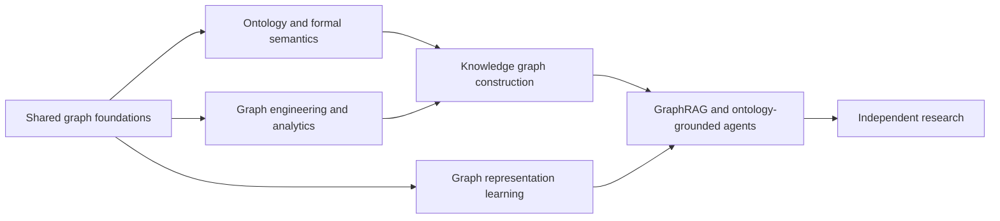

# 12 to 18 Month Curriculum

> [!goal]
> Follow a dependency-ordered, research-oriented program that produces demonstrable systems and research skill, not only reading completion.

## 1. Operating assumptions

This is a **64-week core curriculum** (about 15 months) with an optional 8-week research extension. It assumes your existing strength in CS, mathematics, statistics, ML, deep learning, GenAI and agents.

Recommended weekly load:

| Activity | Hours/week |
|---|---:|
| Primary reading/lectures | 4-5 |
| Derivation and written notes | 2-3 |
| Coding/labs | 6-8 |
| Paper reading/research log | 2-3 |
| Review/teaching | 1 |

At 15-20 hours/week, this is intensive. At 8-10 hours/week, keep the order and stretch the schedule.

> [!important]
> A week is complete only when its artifact exists: tested code, ontology, benchmark, report, or explanation. Watching and highlighting do not count as mastery.

## 2. The three parallel tracks

Maintain all three. Many practitioners become strong in one and incorrectly generalize its assumptions to the others.

## 3. Phase 0 - orientation and environment (Weeks 1-2)

| Week | Learning outcomes | Read/watch | Build and prove |
|---:|---|---|---|
| 1 | Map the field; distinguish graph, DB, KG, ontology, analytics, ML and GraphRAG | [[00_Graph_Field_Mastery_Home]], [[03_Glossary_of_Graph_Fields]], [[02_Knowledge_Map_and_Dependencies]] | Personal skill matrix; 20 competency questions for one domain; Git repository and research log |
| 2 | Install and test the full minimum stack | [[41_Toolchain_Setup]] | Python env; Neo4j; RDFLib/Jena; Protégé; NetworkX; PyG; one CI workflow; smoke tests |

**Gate 0:** You can explain the entire map in ten minutes and run one RDF, one Cypher and one PyG example.

## 4. Phase I - graph foundations (Weeks 3-8)

| Week | Focus | Core artifact |
|---:|---|---|
| 3 | Graph representations, matrices, directed/weighted/multi/bipartite graphs | Implement adjacency list/matrix/CSR conversions and invariants |
| 4 | Traversal, connectedness, DAGs, topological order | BFS/DFS, components, cycle detection, topological sort with tests |
| 5 | Shortest paths and spanning structures | Dijkstra, Bellman-Ford, A*, MST; complexity/assumption comparison |
| 6 | Spectral graph concepts and random walks | Laplacian notebook; random walk and PageRank derivation |
| 7 | Logic, first-order semantics, open/closed world, monotonicity | Logic exercises; model/countermodel notebook |
| 8 | Probability, causal and uncertain graph distinctions | Bayesian/causal/KG comparison; temporal leakage experiment |

Read [[01_Graph_Mathematics_and_Representations]], [[02_Graph_Algorithms_and_Complexity]], [[03_Logic_Knowledge_Representation_and_Semantics]], and [[04_Uncertainty_Causality_and_Probabilistic_Graphs]].

**Gate 1:** Closed-book implementation and explanation of core algorithms; written note separating causal, probabilistic and knowledge graphs.

## 5. Phase II - RDF, ontology and semantic systems (Weeks 9-18)

| Week | Focus | Core artifact |
|---:|---|---|
| 9 | RDF data model, IRIs, literals, blank nodes, datasets | Model a domain in Turtle; round-trip serializations |
| 10 | RDFS semantics and entailment | Entailment fixtures and expected inferred triples |
| 11 | SPARQL basic patterns, filters, optional, union | 30-query workbook with tests |
| 12 | SPARQL aggregation, subqueries, paths, updates and federation | Query optimization and remote-failure lab |
| 13 | Description logics: concepts, roles, interpretations | DL translation and satisfiability exercises |
| 14 | OWL 2 profiles, class expressions and property axioms | Protégé ontology; reasoner classification |
| 15 | Competency questions and ontology requirements | Ontology Requirements Specification plus term glossary |
| 16 | Patterns, upper ontologies and modularization | Reuse/upper-ontology decision record; modular ontology |
| 17 | SHACL, SKOS, provenance, identity and rules | Shapes, concept scheme and PROV trace |
| 18 | Reasoner architecture, testing, CI and governance | Ontology test suite and versioned release v1.0 |

Use [[05_RDF_RDFS_and_Linked_Data]] through [[11_Reasoners_and_Semantic_System_Architecture]]. Build Project 1 in [[37_Portfolio_and_Research_Projects]].

**Gate 2:** A reasoner-tested ontology with at least 25 competency questions, SHACL tests, provenance and published documentation.

## 6. Phase III - graph databases and KG engineering (Weeks 19-28)

| Week | Focus | Core artifact |
|---:|---|---|
| 19 | Property-graph modeling and Cypher | Same domain in Neo4j; 30 Cypher queries |
| 20 | GQL concepts and Gremlin traversal algebra | Cross-language query comparison |
| 21 | Storage layouts, indexes and query plans | Profile and optimize five slow queries |
| 22 | Transactions, partitioning and distributed analytics | Failure/capacity benchmark report |
| 23 | RDF vs property graph and hybrid decisions | Architecture decision record and dual projection |
| 24 | Structured-source mapping and deterministic identity | Incremental source-to-KG pipeline |
| 25 | Text/table extraction and evidence modeling | Schema-constrained extraction with gold set |
| 26 | Entity resolution and knowledge fusion | Blocking/matching/clustering benchmark |
| 27 | Quality, governance, security and versioning | Quality dashboard, release gates and incident drill |
| 28 | Temporal/spatial/probabilistic/hypergraph extensions | Context-rich extension with as-of queries |

Read [[12_Property_Graphs_Cypher_GQL_and_Gremlin]] through [[19_Temporal_Spatial_Probabilistic_and_Hyper_KGs]]. Build Projects 2-4.

**Gate 3:** A replayable, provenance-aware KG pipeline with both RDF and LPG views, reconciliation, entity resolution and operational tests.

## 7. Phase IV - network science and graph data science (Weeks 29-34)

| Week | Focus | Core artifact |
|---:|---|---|
| 29 | Structural profiling, paths and centrality | Reproducible network analysis report |
| 30 | Communities, cores, motifs and null models | Stability/null-model study |
| 31 | Graph features and decision framing | Graph-vs-tabular baseline experiment |
| 32 | GDS pipeline, temporal splits and deployment | Batch scoring pipeline with monitoring |
| 33 | Algorithm selection and failure modes | 20 method cards using [[47_Decision_Trees_for_Graph_Problems]] |
| 34 | Independent analytics project | Project 5 report and presentation |

**Gate 4:** You can defend every algorithm by its assumptions and show whether it changes a real decision.

## 8. Phase V - graph representation learning (Weeks 35-44)

| Week | Focus | Core artifact |
|---:|---|---|
| 35 | Matrix factorization, random-walk embeddings | DeepWalk/Node2Vec-style implementation and baseline study |
| 36 | KGE: TransE, DistMult and ComplEx | PyKEEN/custom benchmark with leakage analysis |
| 37 | KGE: RotatE, rules, temporal/inductive settings | Per-relation and unseen-entity study |
| 38 | Message passing, GCN and normalization | GCN from equations and PyG implementation |
| 39 | GraphSAGE, GAT and GIN | Four-model comparison with ablations |
| 40 | Expressivity, WL, smoothing, squashing, heterophily | Diagnostic synthetic experiments |
| 41 | Relational and heterogeneous GNNs | R-GCN/HGT versus collapsed graph |
| 42 | Temporal GNNs and streaming systems | Rolling-window temporal link prediction |
| 43 | Graph transformers and positional encoding | Transformer/GPS-style replication |
| 44 | Neuro-symbolic learning and full evaluation | Hybrid rule-neural project and benchmark card |

Read [[23_Knowledge_Graph_Embeddings_and_Link_Prediction]] through [[28_Graph_ML_Evaluation_Datasets_and_Benchmarks]]. Build Projects 6-8.

**Gate 5:** You can reproduce one graph ML paper, identify leakage or shortcut risks, and show value over non-graph baselines.

## 9. Phase VI - LLMs, GraphRAG and agents (Weeks 45-52)

| Week | Focus | Core artifact |
|---:|---|---|
| 45 | KGQA, schema grounding and entity linking | Typed NL-to-SPARQL/Cypher assistant |
| 46 | Vector, lexical, graph and structured retrieval | Controlled retrieval benchmark |
| 47 | Entity/path/PPR GraphRAG | Evidence-linked GraphRAG implementation |
| 48 | Community/global GraphRAG and hybrid routing | Router by question type and cost |
| 49 | Ontology-grounded planning and tool schemas | Typed planner/validator/executor |
| 50 | Graph memory and temporal consolidation | Correctable episodic/semantic memory graph |
| 51 | Multi-agent task/artifact/provenance graph | Single-versus-multi-agent evaluation |
| 52 | Security, safety, observability and canary deployment | Red-team suite and production-readiness report |

Read [[29_Knowledge_Graph_and_LLM_Integration]] through [[33_Safety_Evaluation_and_Production_Operations]]. Build Projects 9-10.

**Gate 6:** An agent answers and acts only through typed, authorized, evidence-producing tools and passes adversarial tests.

## 10. Phase VII - research apprenticeship (Weeks 53-60)

| Week | Focus | Core artifact |
|---:|---|---|
| 53 | Select research cluster and build literature graph | 40-paper structured map |
| 54 | Three-pass reading and claim extraction | 10 deep paper notes and comparison matrix |
| 55 | Reproduce environment/data | Reproducible baseline repository |
| 56 | Reproduce headline result | Result table with deviation analysis |
| 57 | Ablation and error analysis | Causal-ish hypothesis map and failure taxonomy |
| 58 | Design one controlled extension | Pre-registered experiment plan |
| 59 | Run extension and robustness tests | Raw results, CIs and negative results |
| 60 | Write replication/extension report | 6-10 page paper-style report and artifact release |

Use [[38_Research_Frontiers_and_Open_Problems]] and [[39_Paper_Reading_Reproduction_and_Writing]].

**Gate 7:** Another person can reproduce your result from a clean machine using your instructions and data version.

## 11. Phase VIII - capstone and publication (Weeks 61-64)

| Week | Focus | Core artifact |
|---:|---|---|
| 61 | Capstone architecture and dataset freeze | Requirements, threat model, evaluation plan |
| 62 | Build, integrate and test | End-to-end system with CI and observability |
| 63 | Evaluate, ablate, red-team and document | Final quantitative/qualitative report |
| 64 | Publish and defend | Demo, technical article, poster/talk, repository, next research proposal |

Choose Project 11 or 12 from [[37_Portfolio_and_Research_Projects]].

## 12. Optional research extension (Weeks 65-72)

- Week 65: reviewer-style literature update;
- Week 66: stronger baselines and compute/data scaling;
- Week 67: external-domain replication;
- Week 68: theory/formal-property analysis;
- Week 69: human/expert evaluation;
- Week 70: revise manuscript and artifact;
- Week 71: workshop/conference submission package;
- Week 72: retrospective and next 12-month agenda.

## 13. Weekly rhythm

| Day | Work |
|---|---|
| Monday | Read standards/book chapter; write questions |
| Tuesday | Derive concepts and implement minimal version |
| Wednesday | Use production library/tool; compare behavior |
| Thursday | Experiment, baseline and test |
| Friday | Read one paper; update literature graph |
| Saturday | Build project artifact and documentation |
| Sunday | Review, teach-back, plan next week |

## 14. Monthly review

At each four-week boundary answer:

1. What can I build now that I could not build before?
2. Which assumptions can I state and test?
3. Which result failed, and why?
4. What is reproducible from a clean environment?
5. What should be removed from the roadmap?
6. Which research question became sharper?

## 15. Exit portfolio

By Week 64 you should have:

- one published ontology with tests;
- one structured/text-to-KG pipeline;
- one dual RDF/property-graph architecture;
- one entity-resolution benchmark;
- one network/GDS case study;
- one KGE and one GNN study;
- one GraphRAG benchmark;
- one ontology-grounded agent;
- one paper reproduction and extension;
- one polished capstone and research proposal.

Proceed immediately to [[35_First_30_60_90_Days]].
