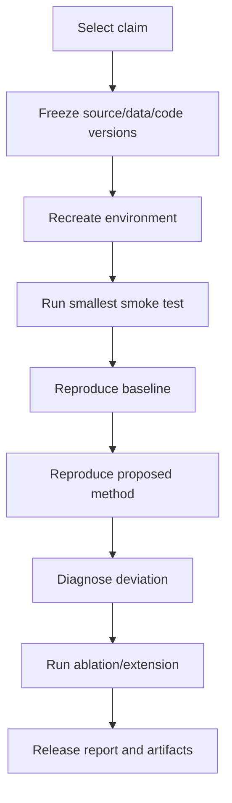

# Paper Reading, Reproduction and Writing

> [!goal]
> Read papers as claims supported by evidence, reproduce them as systems, and write research that another expert can falsify.

## 1. Build a literature graph, not a folder

Represent:

- papers;
- authors/venues;
- problem settings;
- datasets;
- methods/components;
- metrics;
- claims;
- baselines;
- code/artifacts;
- citations and contradictions;
- your experiments.

Edges such as `extends`, `contradicts`, `usesDataset`, `comparesAgainst`, `assumes`, `reproducedBy` expose research gaps better than chronological notes.

## 2. Search strategy

Start from one recent high-quality survey and 3-5 anchor papers. Then use:

- backward citations for foundations;
- forward citations for follow-ups;
- related-work clusters;
- benchmark leaderboards and repositories;
- venue proceedings;
- author/project pages;
- standards and official documentation for definitions.

Set an alert or monthly review for the exact research cluster. Do not chase every graph/LLM paper.

## 3. Three-pass reading

### Pass 1 - relevance (10-15 minutes)

Read title, abstract, figures, headings, conclusion and references. Record:

- problem and setting;
- main claim;
- data/tasks;
- whether code/data exist;
- reason to read deeply.

Reject or defer papers that do not affect your research question.

### Pass 2 - evidence structure (45-90 minutes)

Read fully without reconstructing every proof. Extract:

- assumptions;
- method pipeline;
- training/evaluation split;
- baselines;
- metrics;
- ablations;
- limitations;
- result uncertainty;
- missing comparisons.

Map each headline claim to one or more tables/figures/proofs.

### Pass 3 - reconstruction (2-6 hours)

Re-derive equations/algorithms, inspect code, trace data flow and reproduce a minimal example. Ask what would falsify the claim.

Use [[Template - Paper Note]].

## 4. Claim-evidence table

| Claim | Evidence | Assumptions | Alternative explanation | Your confidence |
|---|---|---|---|---|
| Method improves multi-hop retrieval | Table X on datasets A/B | gold entity links, fixed LLM | larger token budget or better extraction | medium |

This prevents abstract/conclusion language from replacing evidence.

## 5. Paper quality questions

### Problem

Is the setting real, clearly bounded and distinct from prior work?

### Method

What is genuinely new: objective, architecture, data, scale, integration or evaluation?

### Evaluation

Are splits leakage-safe? Baselines strong? Hyperparameter budgets fair? Multiple seeds? Systems cost reported?

### Causality of improvement

Do ablations isolate the proposed mechanism? Could gains come from more data, parameters, text or compute?

### Generalization

Does the evidence support the breadth of the claim? Are domains/tasks independent?

### Reproducibility

Are code, data, environment, preprocessing and checkpoints available?

## 6. Reproduction levels

1. **Artifact verification:** run released code/checkpoint.
2. **Result reproduction:** match a table/figure under stated setup.
3. **Independent reimplementation:** reproduce from paper specification.
4. **Robustness reproduction:** new seeds/hardware/data slices.
5. **Conceptual replication:** test the hypothesis in another domain/dataset.

State your level precisely.

## 7. Reproduction workflow



### Before running

- identify exact commit/tag;
- checksum data;
- record hardware/software;
- inspect preprocessing and split generation;
- estimate compute;
- define acceptable result tolerance;
- create an experiment ledger.

### Diagnose deviations

Possible causes:

- data version/preprocessing;
- nondeterminism/seed;
- library/CUDA differences;
- hidden hyperparameters;
- early stopping/model selection;
- negative sampling/evaluation details;
- metric implementation;
- undocumented postprocessing.

Do not tune until a mismatch disappears without documenting the change.

## 8. Reproducible repository

```text
environment.yml or pyproject.toml
Dockerfile (when useful)
Makefile/task runner
configs/
data/README + checksums
scripts/download_data.*
src/
tests/
experiments/manifest.csv
results/raw/
results/processed/
notebooks/ (analysis only)
reproduce.sh
REPORT.md
```

The final table/figure should be regenerated from raw outputs, not edited manually.

## 9. Experimental design

Write before execution:

- hypothesis;
- independent/dependent variables;
- controlled variables;
- datasets/splits;
- baseline set;
- search budget;
- primary metric;
- statistical plan;
- failure/stop criteria;
- expected result and alternative outcomes.

For graph work, explicitly define graph construction, edge visibility and negative sampling.

## 10. Ablations and controls

Strong ablations remove or replace one mechanism:

- graph edges removed/randomized;
- ontology constraints removed or corrupted;
- vector-only versus graph-only;
- text features removed;
- global attention removed;
- path depth changed;
- equivalent compute/parameter control;
- oracle construction/linking upper bound.

Ablations should test the causal story of the method, not merely list configurations.

## 11. Error analysis

Build a taxonomy and sample errors stratified by:

- relation/question type;
- degree/component;
- temporal range;
- source/domain;
- entity frequency;
- ambiguity;
- prediction confidence;
- success/failure of each pipeline stage.

Trace at least 50-100 cases for a substantial project. Quantify taxonomy frequencies and include representative cases.

## 12. Writing structure

### Abstract

Problem, gap, method, exact setting, key quantitative result and main limitation. Avoid unsupported universal claims.

### Introduction

Why the problem matters; what fails; research question; contributions phrased as verifiable outputs.

### Related work

Organize by approaches and unresolved distinctions, not paper-by-paper summaries.

### Method

Define notation, inputs/outputs, algorithm, assumptions, complexity and reproducibility details.

### Experiments

Questions/hypotheses, datasets, splits, baselines, implementation, metrics, results, ablations and analysis.

### Limitations/ethics

Scope, failure, data/compute, privacy, bias and misuse.

### Conclusion

Answer research questions without introducing new claims.

## 13. Figures and tables

Every figure answers a question. Include uncertainty/error bars when applicable. Captions should be independently understandable. Tables mark best results only after statistical/experimental context; do not hide negative slices in averages.

## 14. Reviewer simulation

Before submission, ask:

1. Is the problem/novelty clear in two paragraphs?
2. Is the strongest baseline missing?
3. Could leakage explain the result?
4. Does evaluation match deployment?
5. Is the mechanism supported by ablation?
6. Are compute/data advantages controlled?
7. Can claims be narrowed?
8. Can an artifact reviewer reproduce it?
9. What result would reverse the conclusion?
10. Are ethical risks handled?

Write a rebuttal to your own paper, then revise before external review.

## 15. Research cadence

- weekly: one deep paper note and one experiment review;
- monthly: literature graph update and research-question revision;
- quarterly: reproduce/extend one paper or release one rigorous study;
- annually: synthesize the subfield and choose the next thesis-sized question.

## 16. Minimum publishable unit

A valuable early paper/report can be:

- a careful benchmark revealing when GraphRAG fails;
- a leakage-resistant split and baseline study;
- a reproduction with a robust negative result;
- a dataset/ontology with high-quality tests;
- a systems study of vector-graph hybrid queries;
- a controlled method improvement with meaningful effect.

Novelty is not only a new neural layer.
