# Decision Trees for Graph Problems

> [!abstract]
> Use these trees before choosing a database, ontology, algorithm or model. Start from the decision and evidence you need, not from the word "graph" or a favorite tool.

## 1. Do you need a graph at all?

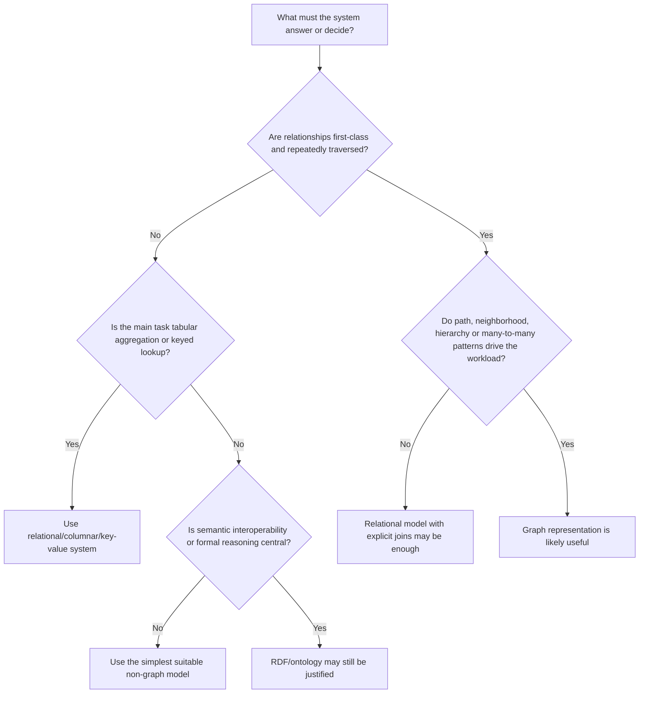

A graph is justified when at least one of these is material:

- path or neighborhood queries dominate;
- relationship types and direction carry business meaning;
- schema varies across connected entity types;
- identity and cross-source integration are central;
- recursive hierarchy/dependency queries are frequent;
- structural algorithms or graph ML are required;
- semantic interoperability, inference or ontology reuse is required.

A graph is not justified merely because the domain contains entities and relationships; every relational schema does.

## 2. RDF, property graph, relational or hybrid?

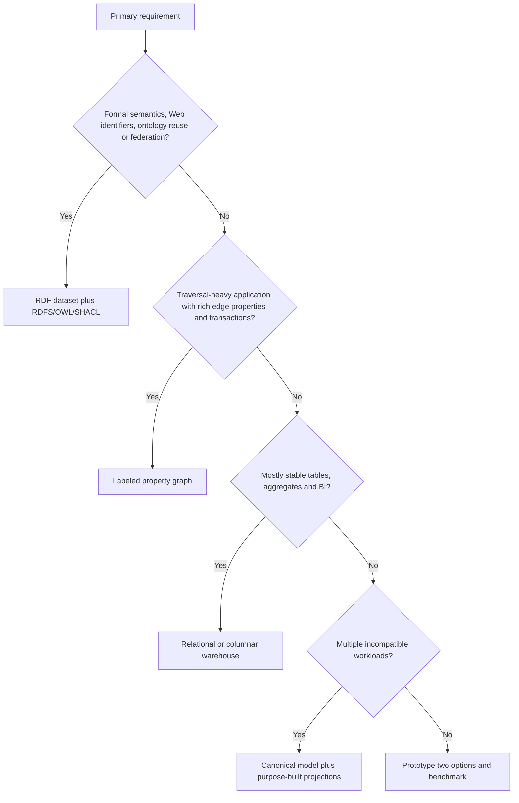

| Requirement | Strong default | Important caveat |
|---|---|---|
| Global identifiers and linked data | RDF | Identity governance is still required. |
| Description-logic inference | RDF/OWL | Reasoning cost and open-world semantics must fit. |
| Constraint validation | SHACL or application schema | Validation is not the same as inference. |
| Interactive traversal | Property graph | Path fan-out and consistency still matter. |
| Edge properties | Property graph or RDF statement pattern | Choose based on semantics/interoperability. |
| Heavy tabular aggregation | SQL/warehouse | Project graph subsets for graph tasks. |
| Vector semantic retrieval | Vector index | It does not replace explicit relation/path logic. |
| Mixed enterprise architecture | Hybrid projections | Avoid unsynchronized dual sources of truth. |

Best hybrid pattern: maintain one governed canonical truth boundary, then build reproducible RDF, property-graph, search and vector projections for workloads.

## 3. Node, relationship, property or event?

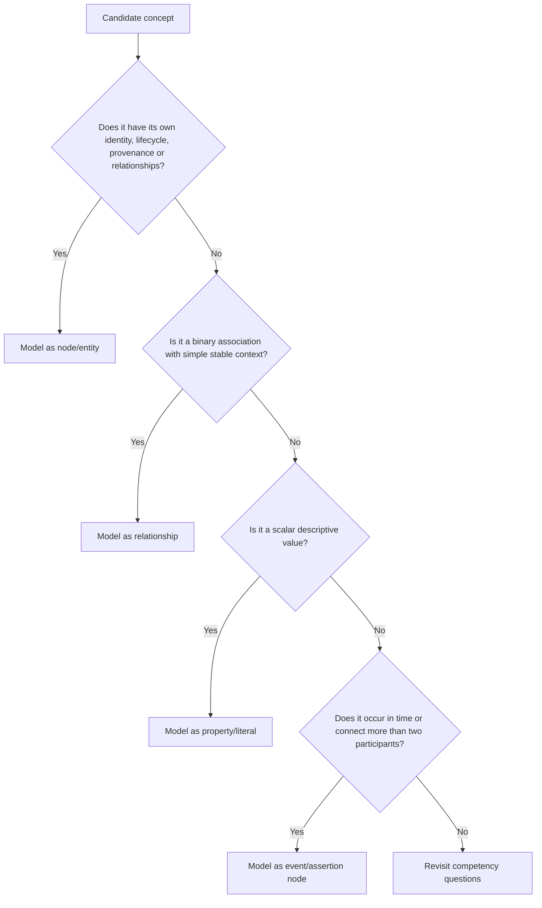

Promote a relationship to an assertion/event node when it needs:

- multiple participants;
- validity interval or transaction time;
- source-specific confidence;
- independent status/lifecycle;
- evidence spans;
- conflicting claims;
- approval or correction history;
- relationships to policies, observations or documents.

## 4. Class, instance or value?

Ask:

1. Can it have members? It may be a class.
2. Is it a particular continuant/event/document/record? It is probably an instance.
3. Is it a controlled category code used as a value? Model as a concept/individual or enumeration according to required semantics.
4. Must subclasses inherit constraints or participate in logical classification? Use a class.
5. Does it change frequently as business reference data? An individual/concept scheme may be safer than changing the ontology schema.

Do not turn every label into a class. Avoid class-individual punning unless you understand the semantic and tooling consequences.

## 5. RDFS, OWL, SHACL or rules?

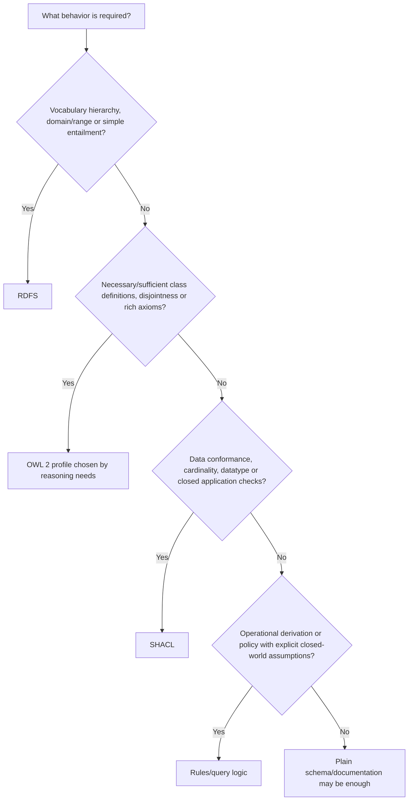

Use combinations deliberately:

- OWL says what follows under its semantics.
- SHACL says what data is accepted under chosen validation targets.
- rules derive operational conclusions under explicit assumptions.
- database constraints protect local storage invariants.

Never expect one language to silently provide the semantics of another.

## 6. Which OWL profile?

| Need | Candidate | Tradeoff |
|---|---|---|
| Large taxonomy, existential restrictions, efficient classification | OWL 2 EL | Limited negation/universal constructs; good for biomedical-style hierarchies. |
| Rule-like scalable inference over many instances | OWL 2 RL | Designed for rule implementation; not all DL expressivity. |
| Query answering with lightweight schema | OWL 2 QL | Rewritable queries; restricted modeling. |
| Maximum OWL 2 DL expressivity | OWL 2 DL | Reasoning can be expensive; discipline required. |
| Custom operational semantics | SHACL/rules/application | Document closure, order and conflict behavior. |

Choose the weakest profile that answers competency questions and passes performance tests.

## 7. Store inference or compute on demand?

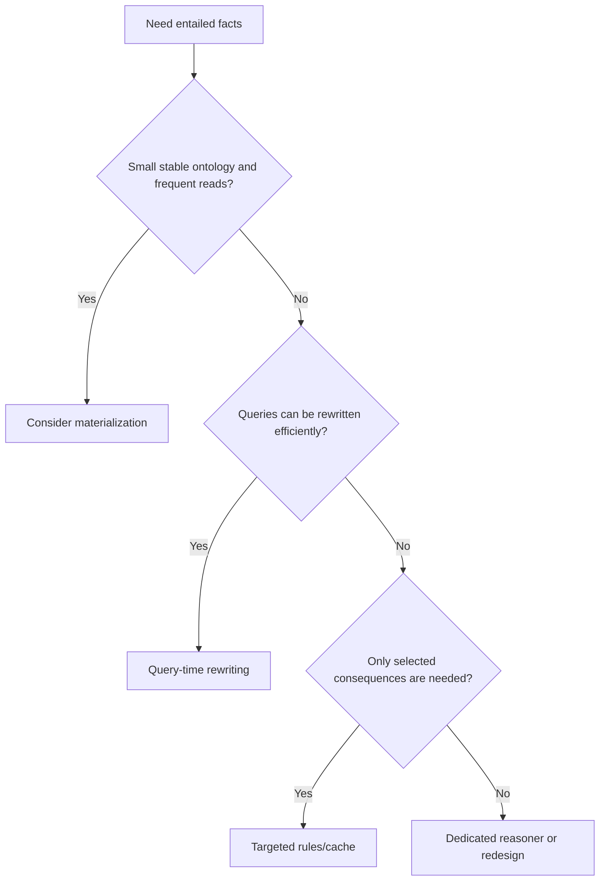

Materialization offers fast reads but creates update, provenance and storage complexity. Query-time reasoning keeps assertions separate but can increase latency. In either case, expose whether a result was asserted or inferred.

## 8. Query language selection

| Environment | Primary language | Think in |
|---|---|---|
| RDF graph/dataset | SPARQL | graph-pattern matching, bindings, datasets, entailment regime |
| Property graph | Cypher/GQL | labeled pattern matching, paths, rows and updates |
| Traversal machine/API | Gremlin | traversers, steps, barriers, side effects |
| Relational graph extension | SQL/PGQ or recursive SQL | tabular relations plus graph patterns |
| In-memory algorithm library | Python/NetworkX/PyG | graph object/tensors and algorithm APIs |

Do not translate syntax mechanically. Null/unbound behavior, duplicates, path semantics, update semantics and inference differ.

## 9. Which graph algorithm?

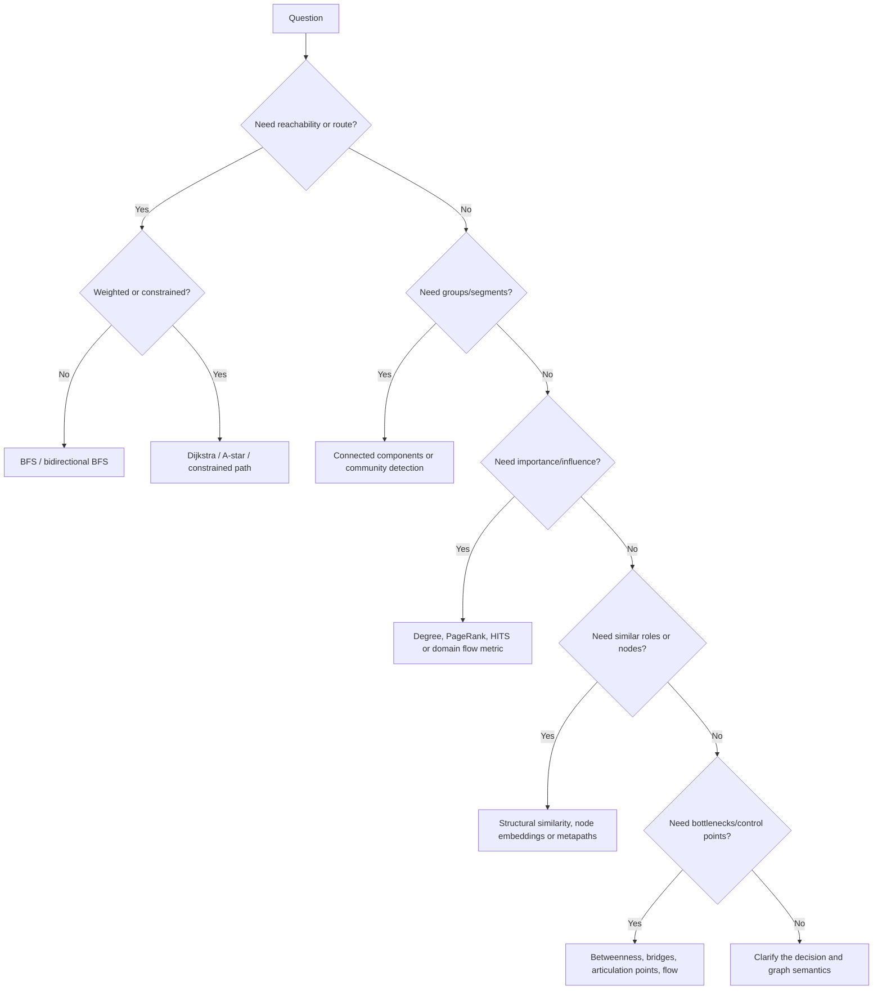

Selection details:

| Problem | First baseline | Escalate when |
|---|---|---|
| Undirected groups | WCC | direction/type/time changes meaning. |
| Dense communities | Leiden/Louvain | overlap/hierarchy/dynamics matter. |
| Influence | PageRank plus degree | edge weights, signed effects or time decay matter. |
| Fraud rings | components, motifs, shared-attribute counts | labels and temporal sequences justify ML. |
| Recommendations | common neighbors, personalized PageRank | rich interactions/features justify embeddings/GNNs. |
| Dependency risk | reachability, centrality, cut vertices | capacity/probability requires flow or simulation. |
| Similarity | Jaccard/Adamic-Adar | typed or semantic relations require metapaths/KGE. |

An algorithm score is a model of structure, not a causal explanation.

## 10. Analytics, embedding or GNN?

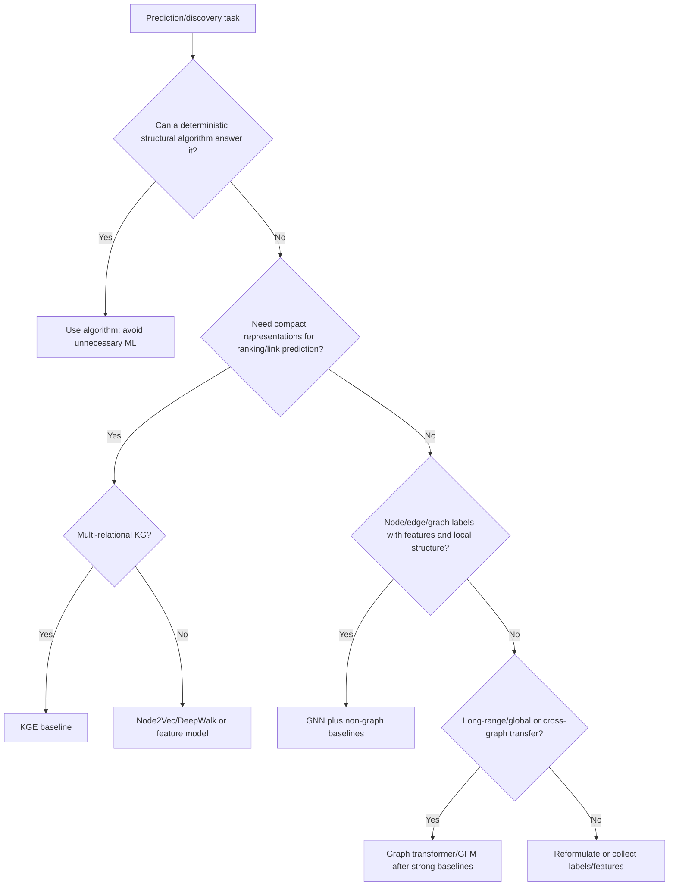

Use graph ML only if topology contains signal unavailable in simpler features and that topology will be available at inference time.

## 11. Which KGE family?

| Relation pattern or need | Starting family | Caution |
|---|---|---|
| Simple translation/path regularity | TransE-like | weak on complex one-to-many/symmetry without care. |
| Symmetric and antisymmetric patterns | DistMult/ComplEx | DistMult cannot model antisymmetry; ComplEx is stronger. |
| Relation-specific projections | TransR/RESCAL-style | more parameters and overfitting. |
| Rotational/compositional patterns | RotatE-style | interpretation depends on data pattern. |
| Literal/text features | multimodal KGE or encoder fusion | prevent textual leakage and compare text-only baseline. |
| Rule-consistent completion | KGE plus constraints/rules | soft scores are not logical entailment. |

Always begin with frequency, type-constrained and simple embedding baselines.

## 12. Which GNN?

| Setting | Baseline | Why |
|---|---|---|
| Homogeneous node classification | MLP, GCN, GraphSAGE | tests feature-only and neighborhood gain. |
| Inductive unseen nodes | GraphSAGE-style | neighborhood aggregator generalizes beyond learned IDs. |
| Attention may help neighbor weighting | GAT | attention is not automatically explanation. |
| Multi-relational graph | R-GCN/relational message passing | relation-specific transformations. |
| Heterogeneous schema | HGT/HAN/metapath model | respects node/edge types. |
| Dynamic event graph | TGN/TGAT/JODIE-style | handles event time and evolving memory. |
| Whole-graph prediction | GIN plus pooling | strong structural baseline. |
| Long-range interactions | positional encodings/transformer/hybrid | higher compute; benchmark against deeper/simple models. |

Check homophily, degree distribution, over-smoothing, over-squashing, temporal availability and inference sampling.

## 13. Vector RAG, graph retrieval or hybrid?

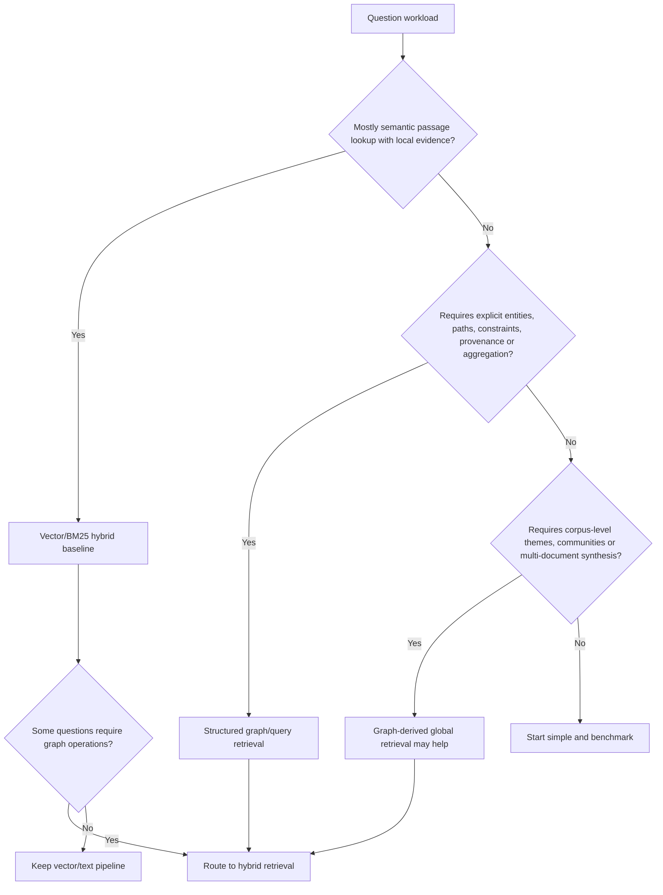

| Question type | Best first route |
|---|---|
| Definition or quoted passage | BM25/vector text retrieval |
| Entity attributes | exact lookup or graph query |
| Multi-hop relation/path | graph query/path retrieval |
| Numerical aggregation | governed database query, not LLM arithmetic |
| Global theme/sense-making | hierarchical/global summaries plus source evidence |
| Fuzzy entity mention | vector/lexical candidate generation, then entity resolution |
| Policy-constrained answer | ontology/rule checks plus evidence retrieval |

GraphRAG is not a universal replacement for vector RAG. Measure routing accuracy and per-question-class gains.

## 14. Ontology-grounded agent or ordinary tool agent?

Use ontology grounding when the agent must:

- resolve terms to governed concepts;
- select tools based on semantic input/output contracts;
- enforce type, scope or policy constraints;
- plan over known action preconditions/effects;
- explain relationships and provenance;
- maintain cross-system identifier consistency.

Do not add an ontology merely to rename a tool catalog. A typed JSON schema may be enough for a small stable tool set.

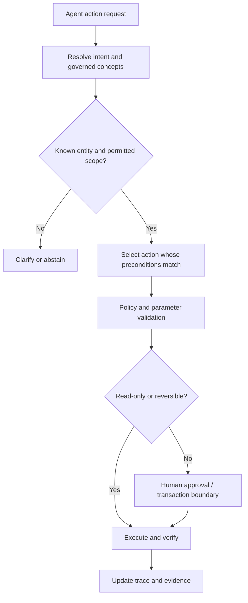

## 15. Agent memory choice

| Memory need | Representation |
|---|---|
| Recent conversational state | bounded message/event log |
| Stable user preferences | governed profile with provenance and consent |
| Entities and relationships | knowledge graph |
| Similar past episodes | vector index over episode summaries plus links |
| Procedures and policies | versioned documents, rules or ontology |
| Plans and dependencies | task graph/state machine |

Do not place all memory in a single graph. Different retention, privacy, update and retrieval semantics require separate stores with controlled links.

## 16. When to use logical reasoning versus prediction

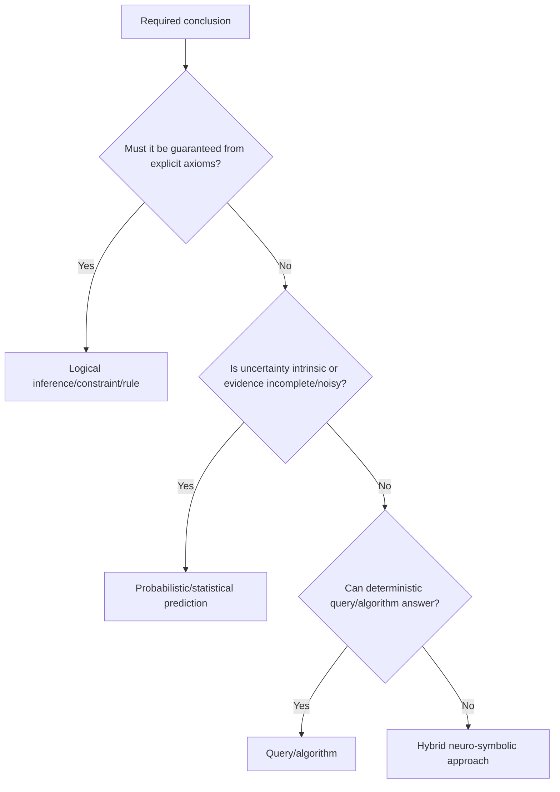

Keep output labels distinct:

- asserted;
- logically inferred;
- computed by deterministic algorithm;
- statistically predicted;
- generated interpretation.

Mixing these categories destroys trust and evaluation clarity.

## 17. Temporal modeling decision

| Requirement | Model |
|---|---|
| Only current state matters | overwrite with audit log, if legally acceptable. |
| Historical valid state | validity interval on assertion/event. |
| Need correction history | bitemporal: valid time plus transaction time. |
| Sequence drives prediction | event stream/temporal graph. |
| Recurring intervals/uncertain dates | explicit temporal entity and interval algebra. |

Never infer event order from ingestion timestamps unless that is the defined semantics.

## 18. Entity resolution method

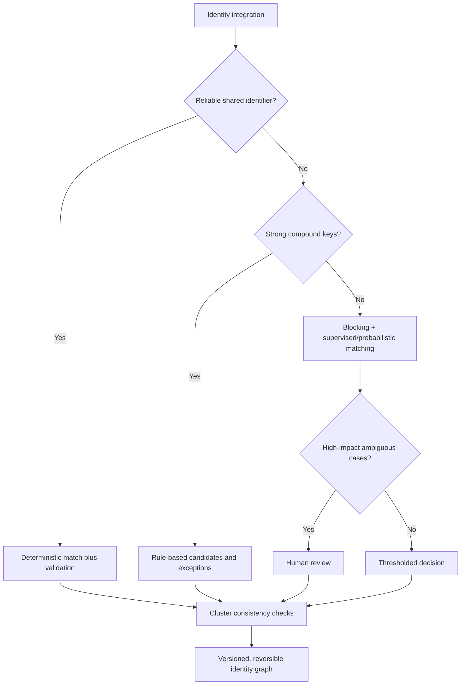

Optimize end-to-end entity quality, not pair accuracy alone. Blocking recall is an upper bound on downstream matching recall.

## 19. Production architecture decision

Choose architecture by truth ownership:

1. Which system is authoritative for each fact type?
2. What is the identifier and change-data contract?
3. Which layer performs resolution, validation and inference?
4. Which projections are read models only?
5. How are corrections propagated and audited?
6. What can the agent read or write?
7. What latency, consistency and availability are required?

A robust pattern:

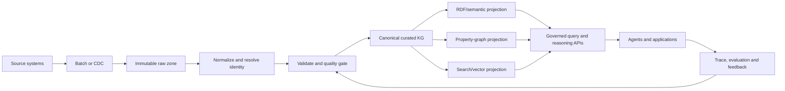

## 20. Research-method decision

| Claim | Required design |
|---|---|
| Better model architecture | same data/splits/tuning budget; ablations; multiple seeds. |
| Better retrieval | fixed generator where possible; retrieval metrics plus answer metrics. |
| Better ontology | competency-question coverage, consistency, expert review, task outcomes. |
| Better KG construction | gold extraction/resolution set, quality dimensions, downstream effect. |
| Better graph system | standardized and application workloads, correctness, resource and tail latency. |
| Better agent | task success, safety, cost, latency, failure taxonomy and human baseline. |
| Generalization | entity/time/domain/cross-graph splits matching the claim. |

If the experiment cannot distinguish the proposed cause from data leakage, model scale or prompt variation, it does not support the claimed conclusion.

## 21. Fast architecture review checklist

- [ ] The competency questions and users are explicit.
- [ ] The fact grain and identity rules are written.
- [ ] Graph choice beats a simpler baseline on a stated requirement.
- [ ] Open/closed-world assumptions are explicit.
- [ ] Asserted, inferred, computed and predicted data are distinguishable.
- [ ] Time, provenance, confidence and source conflicts are modeled where needed.
- [ ] Query depth, fan-out, result size and cost are bounded.
- [ ] Entity resolution is measured and reversible.
- [ ] Evaluation splits match deployment and avoid graph leakage.
- [ ] Agent tools are typed, policy-scoped and observable.
- [ ] Draft standards/vendor features are isolated behind compatibility tests.
- [ ] Failure, rollback, deletion and correction paths exist.

## Related notes

- [[14_RDF_vs_Property_Graphs_and_Interoperability]]
- [[22_Graph_Algorithm_Selection_Guide]]
- [[27_Neuro_Symbolic_AI_and_Logical_Learning]]
- [[28_Graph_ML_Evaluation_Datasets_and_Benchmarks]]
- [[30_GraphRAG_and_Hybrid_Retrieval]]
- [[31_Ontology_Grounded_Agents]]
- [[33_Safety_Evaluation_and_Production_Operations]]
