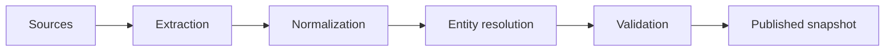

# Dataset Card - <dataset>

## Summary

- Purpose:
- Owner/maintainer:
- Source URL/system:
- Version/snapshot:
- License/terms:
- Privacy classification:

## Unit and graph semantics

- Entity/fact/event grain:
- Node types:
- Edge types:
- Direction and weight meaning:
- Time meaning:
- Identity policy:
- Missing-value meaning:

## Construction

- Filtering:
- Deduplication:
- Label creation:
- Negative sampling:
- Inference/materialization:
- Human annotation/adjudication:

## Statistics

| Measure | Value |
|---|---:|
| Nodes | |
| Edges/triples | |
| Node/edge types | |
| Connected components | |
| Time range | |
| Label prevalence | |
| Missingness | |

Include type/relation/degree distributions rather than only totals.

## Splits

| Split | Unit | Date/domain rule | Count | Leakage controls |
|---|---|---|---:|---|
| train | | | | |
| validation | | | | |
| test | | | | |

## Known limitations and bias

- coverage gaps:
- sampling bias:
- annotation uncertainty:
- identity errors:
- temporal staleness:
- source-policy effects:
- representational harms:

## Intended uses

## Out-of-scope or prohibited uses

## Quality checks

- [ ] schema/SHACL/database constraints pass;
- [ ] duplicate and inverse leakage audited;
- [ ] split isolation tested;
- [ ] provenance coverage measured;
- [ ] license/privacy approved;
- [ ] deletion/correction process exists.

## Change history

| Version | Date | Change | Compatibility impact |
|---|---|---|---|
| | | | |
