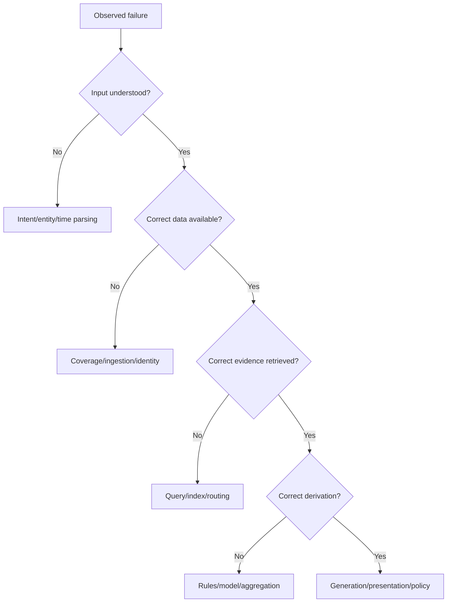

# Failure Analysis - <system>

## Scope

- build/version:
- dataset/query set:
- time range:
- sample strategy:

## Failure taxonomy

| Code | Class | Definition | Example |
|---|---|---|---|
| ID | identity resolution | wrong/missing entity link | |
| SC | schema/ontology | concept or relation mismatch | |
| RT | retrieval | evidence not retrieved or over-expanded | |
| RS | reasoning | invalid inference or missing rule | |
| TM | temporal | wrong as-of/period interpretation | |
| AG | aggregation | grain/duplicate/unit error | |
| GN | generation | unsupported or distorted claim | |
| PL | policy/safety | unauthorized or unsafe action | |
| OP | operations | timeout, stale index, unavailable tool | |

## Error log

| Case | Expected | Actual | Evidence | Root layer | Severity | Reproducible |
|---|---|---|---|---|---|---|
| | | | | | | |

## Root-cause tree

## Distribution

Report failure rates by question type, relation, entity degree, time, user group and source rather than only total accuracy.

## Corrective actions

| Action | Layer | Expected effect | Verification | Owner | Priority |
|---|---|---|---|---|---|
| | | | | | |

## Regression tests added

- [ ] minimal fixture;
- [ ] expected result;
- [ ] adversarial variant;
- [ ] performance/safety check.
