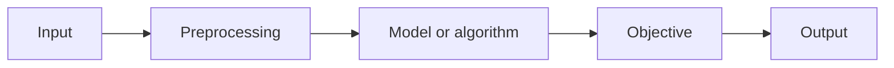

# <Full paper title>

## Citation

**Authors:**  
**Venue/year:**  
**DOI/OpenReview/arXiv:**  
**Code/data:**  
**License:**  

## One-sentence claim

> The paper claims that...

## Why this matters to my research

- Problem connection:
- What decision it may change:
- Closest notes/projects:

## Problem formulation

- **Input:**
- **Output:**
- **Task setting:** transductive / inductive / temporal / cross-domain / other
- **Assumptions:**
- **What is out of scope:**

## Method reconstructed

### Core equations or algorithm

Write the method in your own notation. Define every variable.

### What is actually new?

1.
2.
3.

Separate new architecture, new data, new objective, new evaluation and new scale.

## Data and evaluation

| Item | Details |
|---|---|
| Dataset/snapshot | |
| Construction | |
| Split unit | entity / edge / time / graph / domain |
| Negative sampling | |
| Baselines | |
| Metrics | |
| Seeds/statistics | |
| Compute | |
| Leakage checks | |

## Main results

| Claim | Evidence/table/figure | Effect size | My confidence |
|---|---|---:|---|
| | | | low/medium/high |

## Assumption and failure audit

- [ ] Training/test topology separation is clear.
- [ ] Future information is unavailable at prediction time.
- [ ] Hyperparameter budgets are comparable.
- [ ] Strong simple and non-graph baselines exist.
- [ ] Ablations isolate the claimed mechanism.
- [ ] Multiple seeds/uncertainty are reported.
- [ ] Dataset construction does not encode the answer.
- [ ] License and reproducibility are adequate.

### Threats to validity

**Internal:**  
**External:**  
**Construct:**  
**Statistical:**  

## Three-level summary

### 30 seconds

### 3 minutes

### Technical deep explanation

## Questions for the authors

1.
2.
3.

## Reproduction plan

- **Minimum result to reproduce:**
- **Environment:**
- **Expected artifact:**
- **Deviation from paper:**
- **Stop rule:**

## Extension ideas

1. Controlled extension:
2. Different domain/split:
3. Failure-focused study:

## Connections

- Builds on:
- Contradicts:
- Similar to:
- Use in project:

## Final judgment

**Strengths:**  
**Weaknesses:**  
**What I will retain:**  
**Rating (1-5):**  
