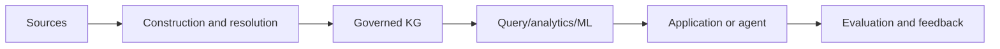

# <Project name>

## Problem

## Users and decisions

## Why a graph/ontology is justified

State the non-graph baseline and why it is insufficient or complementary.

## Competency questions / tasks

1.
2.
3.

## Architecture



## Semantic model

- identity:
- time:
- provenance:
- ontology/shape versions:
- asserted/inferred/predicted boundaries:

## Evaluation

| Layer | Metric | Baseline | Target |
|---|---|---|---|
| construction | | | |
| retrieval/query | | | |
| model/answer | | | |
| system | | | |
| safety | | | |

## Milestones

- [ ] M0 problem and baseline
- [ ] M1 data and ontology
- [ ] M2 working vertical slice
- [ ] M3 evaluation and failure analysis
- [ ] M4 reproducible release

## Reproduction

```bash
# exact setup and run commands
```

## Limitations and responsible-use notes

## Demo narrative

Explain the problem, one difficult example, the graph-specific reasoning, evidence and measured improvement.
