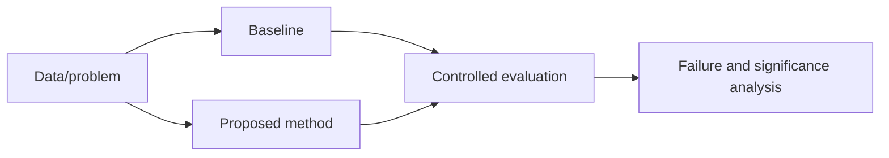

# Research Proposal - <working title>

## 1. Problem and significance

What concrete failure, cost or scientific gap exists? Who is affected?

## 2. Research question

A narrow, answerable and falsifiable question.

## 3. Gap in prior work

| Closest work | What it solves | What remains unsupported |
|---|---|---|
| | | |

## 4. Hypotheses

- H1:
- H2:
- Null/alternative explanation:

## 5. Proposed contribution

- method/system/data/benchmark/theory/empirical finding:
- what is new:
- what is deliberately not claimed:

## 6. Method

## 7. Evaluation design

- datasets and licenses:
- split/generalization claim:
- baselines:
- metrics:
- ablations:
- statistical analysis:
- resource budget:
- human/expert evaluation:
- reproducibility plan:

## 8. Risks

| Risk | Probability | Impact | Mitigation/stop rule |
|---|---|---|---|
| | | | |

## 9. Ethics, privacy and misuse

## 10. Milestones

| Milestone | Artifact | Exit criterion |
|---|---|---|
| M1 | | |

## 11. Publishable minimum

What useful result remains if the proposed method does not outperform?

## 12. Open-science package

- code:
- data/fixtures:
- environment:
- experiment logs:
- model/ontology cards:
