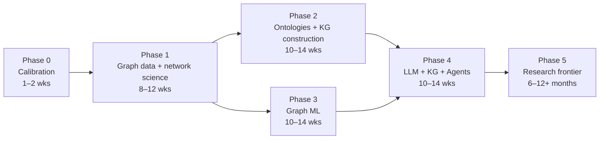
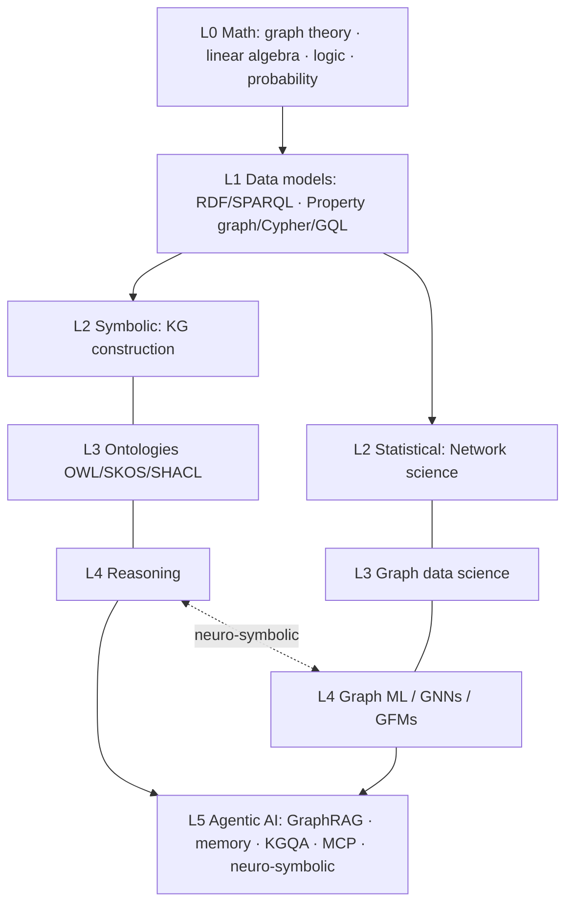

# 🕸️ Graph Mastery Vault — Home

> [!abstract] Purpose
> A study vault for **Knowledge Graphs, Ontologies, Graph Data Science, Graph ML and Agentic GraphRAG**. Work through the phases in order. Every concept note ends with **self-test flashcards** (`Question::Answer` format for the *Spaced Repetition* plugin).

## 🗺️ Roadmap at a glance

## 🧭 Maps of Content (MOCs)
| Phase | MOC | What you learn |
|---|---|---|
| 0 | [[MOC - Foundations]] | Graph theory, spectra, logic |
| 1 | [[MOC - Network Science and GDS]] | Random graphs, centrality, communities, link prediction |
| 1 | [[MOC - Graph Data Models]] | Property graphs, Cypher, RDF, SPARQL, GQL, graph DBs |
| 2 | [[MOC - Ontology and Semantic Web]] | Description logics, OWL 2, SKOS, SHACL, ontology engineering |
| 2 | [[MOC - KG Construction]] | IE, entity linking, entity resolution, LLM extraction, quality |
| 3 | [[MOC - Graph ML]] | Embeddings, GNNs, expressivity, transformers, GFMs |
| 4 | [[MOC - LLM KG and Agents]] | GraphRAG, reasoning on graphs, text-to-Cypher, agent memory, MCP |
| 5 | [[MOC - Related Fields]] | Causal graphs, PGMs, hypergraphs/TDL, graph signal processing |
| All | [[MOC - Projects]] | 11 portfolio projects, beginner → research |
| 5 | [[MOC - Research]] | Open problems, paper list, venues, research workflow |
| All | [[MOC - Resources]] | Books, courses, tools, datasets |

## ▶️ Start here
1. Read [[How to Use This Vault]] (10 min).
2. Open [[Study Tracker]] and set your start date.
3. Begin with [[Graph Theory Essentials]] → [[Spectral Graph Theory]] → [[Logic for Knowledge Representation]].
4. Keep [[Glossary]] open in a side pane.

## 🧠 The mental model in one picture

