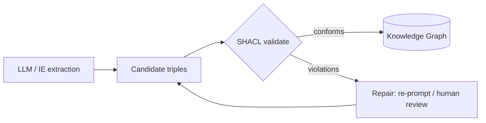

# SHACL & ShEx — Validating Graphs

> [!summary]
> **SHACL** (W3C, 2017) checks RDF data against **shapes** under closed-world semantics. It's the quality gate for KG pipelines — especially LLM-extracted ones.

## SHACL concepts
- **Shapes graph** vs **data graph**
- `sh:NodeShape` with **targets** (`sh:targetClass`, `sh:targetNode`, `sh:targetSubjectsOf`)
- `sh:PropertyShape` with `sh:path` + constraints: `sh:minCount`, `sh:maxCount`, `sh:datatype`, `sh:class`, `sh:pattern`, `sh:in`, `sh:minInclusive`, `sh:node`, `sh:closed`
- **SHACL-SPARQL** for custom constraints; **SHACL Rules** (Advanced Features) for inference
- Output: **validation report** with focus node, path, message, severity

```turtle
ex:PersonShape a sh:NodeShape ;
    sh:targetClass ex:Person ;
    sh:property [
        sh:path ex:email ;
        sh:datatype xsd:string ;
        sh:pattern "^[^@]+@[^@]+$" ;
        sh:minCount 1 ; sh:maxCount 1 ;
    ] ;
    sh:property [
        sh:path ex:worksFor ;
        sh:class ex:Organization ;
    ] .
```

```python
from rdflib import Graph
from pyshacl import validate
data = Graph().parse("data.ttl"); shapes = Graph().parse("shapes.ttl")
conforms, report_graph, report_text = validate(data, shacl_graph=shapes, inference="rdfs")
print(conforms); print(report_text)
```

## ShEx
Shape Expressions — grammar-like, compact syntax (popular in Wikidata via *EntitySchemas*). Same goal, different style.

## Where SHACL fits


## My notes


## Self-test #flashcards/ontology
SHACL uses which world assumption?::Closed-world — missing required values are violations.
What does sh:targetClass do?::Selects all instances of a class as focus nodes for the shape.
Python library for SHACL validation?::pySHACL
OWL vs SHACL in one line?::OWL infers new facts; SHACL validates data against constraints.
ShEx is used where notably?::Wikidata EntitySchemas.
