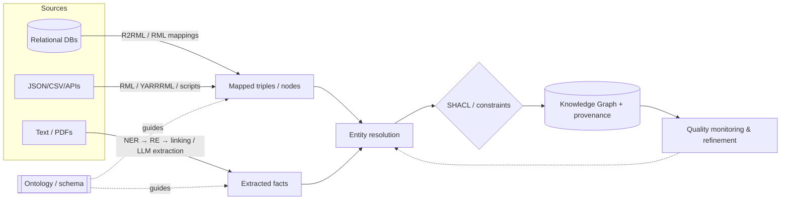

# KG Construction Pipeline

> [!summary]
> A KG is built from **structured** (DBs, CSV, APIs), **semi-structured** (JSON, HTML tables, infoboxes) and **unstructured** (text, PDFs) sources, unified under an ontology, deduplicated, validated and loaded with provenance.

## Key techniques
- **Mapping languages:** R2RML (W3C, relational→RDF), RML (generalises to CSV/JSON/XML), YARRRML (human-friendly YAML). Engines: RMLMapper, Morph-KGC.
- **Virtual KGs (OBDA):** don't materialise — rewrite SPARQL to SQL on the fly (**Ontop**, OWL 2 QL).
- **Text:** see [[Information Extraction and Entity Linking]] and [[LLM-based KG Construction]].
- **Identity:** mint stable IRIs/IDs; [[Entity Resolution]] before loading.
- **Provenance:** keep `source`, `extracted_at`, `extractor_version`, `confidence`, link back to chunk/document (PROV-O or properties). Essential for GraphRAG citations.
- **Incremental updates:** change data capture, upserts (`MERGE`), temporal validity.

## Quality gates
1. Schema conformance (SHACL)
2. Sample-based precision (label 100–200 facts)
3. Coverage / recall against a gold subset
4. Duplicate rate after ER

## My notes

## Self-test #flashcards/kg-construction
What is R2RML?::W3C mapping language from relational databases to RDF.
What is a virtual KG / OBDA?::Querying relational data through an ontology by rewriting SPARQL to SQL without materialising triples (e.g., Ontop).
Why store provenance for every extracted fact?::For trust, debugging, updates/deletions, and citations in GraphRAG answers.
Name three quality gates for a KG pipeline.::SHACL validation, sampled precision labelling, recall vs a gold subset (plus duplicate rate).
