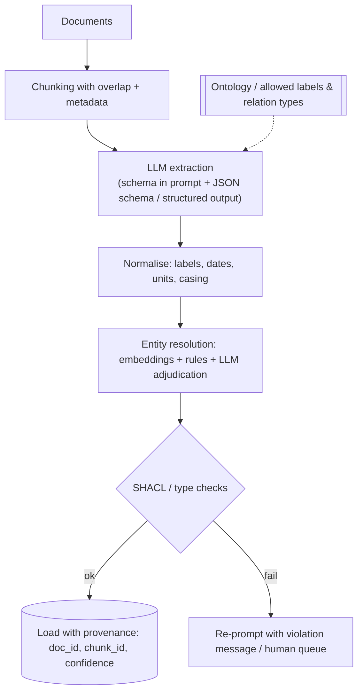

# LLM-based KG Construction

> [!summary]
> LLMs extract entities and relations with almost no training data, but produce **inconsistent schemas, duplicates and hallucinated facts**. The reliable pattern: **ontology-guided structured extraction + normalisation + ER + SHACL validation + provenance**.

## Reference pipeline


## Pseudocode
```python
from pydantic import BaseModel
from typing import Literal

class Entity(BaseModel):
    name: str
    type: Literal["Person", "Organization", "Product", "Location"]

class Relation(BaseModel):
    head: str
    type: Literal["WORKS_FOR", "PRODUCES", "LOCATED_IN"]
    tail: str
    evidence: str              # quote from the chunk

class Extraction(BaseModel):
    entities: list[Entity]
    relations: list[Relation]

# result = llm.structured_output(prompt(chunk, ontology), schema=Extraction)
# drop relations whose head/tail types violate domain/range; keep evidence for provenance
```

## Tools
Neo4j LLM Graph Builder · `neo4j-graphrag` (`SimpleKGPipeline`) · LangChain `LLMGraphTransformer` · LlamaIndex `PropertyGraphIndex` · Microsoft GraphRAG indexer · Graphiti (incremental, temporal) · Cognee.

## Design decisions
- **Schema-free vs schema-guided:** schema-free = high recall, messy; schema-guided = cleaner, may miss facts. Common compromise: guided types + "OTHER" bucket reviewed later.
- **Granularity of chunks** affects recall and cost.
- **Evidence spans** enable verification and citations.
- **Cost:** extraction is usually the dominant GraphRAG cost — measure tokens/document.

## Evaluate
Precision on sampled triples, recall on gold set, duplicate rate, schema-violation rate, $/1k docs. Compare with a classic pipeline ([[P03 Text to KG Pipeline]]).

## Research angle
LLMs4OL challenge (ontology learning), ontology-grounded extraction, KG repair → [[Open Problems]].

## My notes


## Self-test #flashcards/kg-construction
Three typical failure modes of LLM KG extraction?::Schema drift/inconsistent types, duplicate entities, hallucinated facts.
Why store an evidence span with each extracted relation?::For verification, provenance, and citations in downstream answers.
What usually dominates GraphRAG indexing cost?::LLM-based entity/relation extraction over all chunks.
Schema-guided vs schema-free extraction trade-off?::Guided = cleaner and consistent but may miss facts; free = higher recall but messy.
