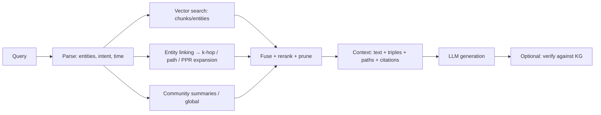

# GraphRAG — Overview

> [!summary]
> Retrieval-augmented generation that uses **graph structure** to retrieve *connected* evidence (multi-hop facts, entity neighbourhoods, community summaries) instead of only similar chunks.

## Why graphs help
- **Multi-hop questions:** "Which suppliers of our top product are in regions hit by the flood?"
- **Global sensemaking:** "What are the main themes across 10k documents?" (vector RAG retrieves locally)
- **Explainability:** paths and entities = citations
- **Structured constraints:** filter by type/time/relationship

## Taxonomy (Zhang et al. survey, arXiv 2501.13958)
| Family | Graph source | Examples |
|---|---|---|
| **Knowledge-based** | Existing KG (Wikidata, enterprise KG) | KG-RAG, G-Retriever, SubgraphRAG, ToG |
| **Index-based** | Graph built from documents | Microsoft GraphRAG, LightRAG, HippoRAG |
| **Hybrid** | Vector + graph + keyword | Neo4j VectorCypher/HybridCypher retrievers |

## Generic pipeline

## Retrieval granularities
nodes · triples · paths · subgraphs · communities · chunks linked to entities (most practical).

## When NOT to use GraphRAG
> [!warning]
> **GraphRAG-Bench** (ICLR 2026) shows GraphRAG **frequently underperforms vanilla RAG** on simple fact retrieval and some summarisation tasks; gains appear for complex multi-hop / cross-document reasoning. Index cost is also much higher. ⇒ Measure against strong vector + rerank baselines on *your* workload. See [[Evaluating GraphRAG]].

## My notes

## Self-test #flashcards/llm-kg
Three families of GraphRAG?::Knowledge-based (existing KG), index-based (graph built from documents), hybrid.
Two question types where GraphRAG tends to help?::Multi-hop/cross-document reasoning and global sensemaking/summarisation over a corpus.
Key finding of GraphRAG-Bench?::GraphRAG often underperforms vanilla RAG on simple tasks; it helps mainly on complex reasoning — graphs should be used selectively.
