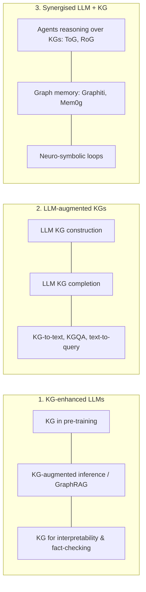

# Unifying LLMs and KGs — the Roadmap

> [!summary]
> Pan et al. (IEEE TKDE 2024) frame the field in **three paradigms**. Every modern system fits one — use this as your mental index.

## Complementary strengths
| | LLMs | KGs |
|---|---|---|
| Knowledge | Implicit, broad, may hallucinate | Explicit, precise, verifiable |
| Updates | Retraining/RAG needed | Edit a triple |
| Reasoning | Flexible, fuzzy | Exact, symbolic, traceable |
| Language | Excellent | None |
| Coverage | Very broad | Incomplete |

## Where systems sit
- Paradigm 1: [[GraphRAG Overview]], [[Microsoft GraphRAG]], [[LightRAG and HippoRAG]]
- Paradigm 2: [[LLM-based KG Construction]], [[Text-to-Cypher and Text-to-SPARQL]]
- Paradigm 3: [[Reasoning on Graphs]], [[Agent Memory as Knowledge Graphs]], [[Neuro-Symbolic AI]]

## My notes

## Self-test #flashcards/llm-kg
Three paradigms of the Pan et al. LLM–KG roadmap?::KG-enhanced LLMs, LLM-augmented KGs, and synergised LLM+KG.
Into which paradigm does LLM-based KG construction fall?::LLM-augmented KGs.
Into which paradigm do agents like Think-on-Graph fall?::Synergised LLM + KG.
